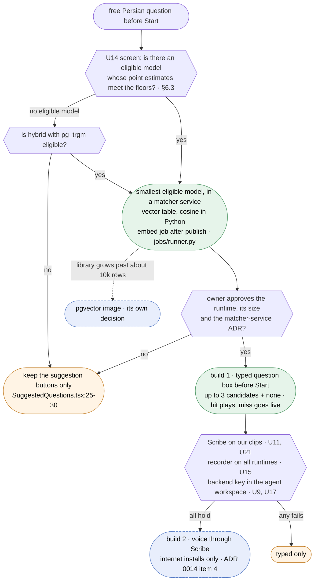

# Spike: How should the backend find a library answer for a free Persian question before any live session?

| Field   | Value                                      |
| ------- | ------------------------------------------ |
| Created | 2026-10-18                                 |
| Updated | 2026-10-18                                 |
| Status  | Open                                       |
| Domain  | assistant                                  |
| Author  | `rag-t1-res` (Claude Opus 5.5), mission `20260925-optionb`, team `rag-t1` |
| Outcome | → ADR                                      |

Codebase claims cite `file:line` at `main@0927cb3`; `.../` is `apps/api/services/orchestrator/`.
"Option E" and "§" point at `docs/features/response-caching/RESEARCH.md` (the earlier spike).
External pages were read on 2026-10-18; inference is labelled. Nothing was installed, downloaded
or run, and no paid API was called. `Resolved` is the owner's call after the §6.3 experiment.

## 1. The question

The owner, 2026-10-02: "For each question we first check whether the answer is in our local
dataset. That is our offline RAG. [...] If the user's answer is in the local dataset, we do not go
to LiveAvatar." The online dataset is the ElevenLabs agent.

**How should the backend find a library answer for a user's free Persian question (typed, or
spoken and transcribed) before any live session: which embedding model, where the vectors live (a
column compared in Python, or `pgvector`), how a spoken question is transcribed before a session,
and how a match is shown, so that a hit plays the recorded answer and a miss goes live?**

## 2. Why it is open

- **Persian ranking is unmeasured** (U14 in the earlier spike, §7). If a model puts the wrong
  sibling first, the user skims, taps it, and hears a confident answer in the practitioner's face
  to a question they did not ask (Option E, "The confirm step").
- **The library is not what the earlier spike assumed**: IT services with English terms, not
  medical pairs (§4.3). No source covers that mix.
- **Speech before a session is new**, and **a new runtime** of up to 1 GB plus 2.3 GB of weights
  enters the installs (§5.2).

Guessing wrong costs trust (a wrong answer) or size (a heavy model a small one would match). The
experiment in §6.3 is cheap next to both.

## 3. Constraints

| # | Constraint | Source |
| - | ---------- | ------ |
| K1 | Embeddings run locally. No hosted embedding API. | ADR 0014 item 4, `docs/DECISIONS/0014-conversation-data-retention.md:171-176` |
| K2 | Speech before a session may go only to the ElevenLabs workspace that runs the live agent, and only on installs with internet. Otherwise a local model, or no voice input. | `0014:166-173` |
| K3 | On a miss, one draft per visit may be stored. Its audio is not kept after transcription. Nothing is written before the consent step exists. | `0014:63-68,78-82` |
| K4 | Conversation text is never logged. It travels in a request body, never a URL. | `docs/SECURITY.md:16-18,26-27`, `0014:54-58` |
| K5 | The draft, speech-to-text and match endpoints each get their own rate limit. | `0014:187-189` |
| K6 | Targets: `mobile` and `web`. The widget plays no library entry until it signs users in. `admin` sees vectors only indirectly. | `.../src/library/router.py:1-5`, `docs/features/response-caching/SPEC.md:76-77` |
| K7 | A call slower than "a few seconds" must be a `202` job. The match must answer while the user waits, so it must stay under that. | `docs/API.md:502` |
| K8 | Migrations are append-only. | `.../migrations/006_library_entries.sql:1-2` |
| K9 | A no-internet install must still work (`0006-backend-stack.md:21`). | ADR 0006 |
| K10 | A hit's question becomes a chat turn only if ADR 0016 (`Proposed`) decides so under ADR 0014. The matcher only returns enough to make it possible. | `docs/DECISIONS/0016-chat-and-message-storage.md:1-3,294-297` |
| K11 | Persian and RTL. All new text in `en` and `fa`. | `CLAUDE.md`, i18n rules |

## 4. What the codebase already does

### 4.1 What is still true from Option E, and what changed

The library was built by PRs #45 to #52 (`git log --oneline` at `0927cb3`). Option E's matcher
design (§5, "Which matcher", `docs/features/response-caching/RESEARCH.md:840-880`) holds with these
updates:

| Option E said | Status at `0927cb3` |
| ------------- | ------------------- |
| Closed retrieval over the approved list, up to three candidates above a floor, or "none" (`:842-860`) | Still the design. No code exists for it. |
| No vector database "at this scale", tens or hundreds of entries (`:861-870`) | Now measured: 392 questions in the source, 120 rendered (`docs/features/response-caching/SPEC.md:135,947`). The size is known, not estimated. |
| A vector column "on the approved-answer table", written "in the same transaction as the approval", with model id and version (`:864-868`) | The approval step now exists. Publishing is one transaction that locks the entry, sets the status and writes a review row (`.../src/library/service.py:188-266`). A published entry cannot be edited in place (`service.py:62-70`), so a vector written at publish stays valid until the entry leaves `published`. |
| "Which language's approved entries does a user see?" (open question, `:1533-1534`) | Answered by the schema: every entry has `language` `fa` or `en` (`006_library_entries.sql:17`), and suggestions filter on it (`.../src/database.py:961-973`). |
| The confirm screen at two render sites (`:720`) | The pick-from-a-list UI now exists: `SuggestedQuestions` shows the questions under Start as 44 px buttons (`apps/frontend/src/features/answer-library/SuggestedQuestions.tsx:25-30`). Matched candidates can use the same component and the same allowlist schema (`.../src/schemas.py:310-320`). |
| `pgvector` is not in the Postgres image (§4.5, `RESEARCH.md:289-292`) | Still true: the image is `postgres:16-bookworm` (`docker-compose.yml:13`). |
| No machine-learning runtime (`requirements.txt:1-15`) | Still true: `.../requirements.txt:1-15` has no `torch`, `onnxruntime` or `sentence-transformers`. The image is `python:3.12-slim-bookworm` with `curl` and `ffmpeg` only (`.../Dockerfile:1,10-12`). CPU only. |
| A job runner is needed (§4.1 row 5) | Built: an in-process runner over `generation_jobs` (`.../src/jobs/runner.py:1-5`, ADR 0015). A re-embed job could use it. |

### 4.2 What does not exist

- **No question input before Start.** The control layer renders only when `isSessionOpen`
  (`apps/frontend/src/pages/conversation/VideoConversationPage.tsx:442-455`), the composer's
  `canSend` is `canControl` (`:457-462`), and `sendText` needs a session
  (`apps/frontend/src/features/assistant/useAssistantSession.ts:498-501`).
- **No recorder.** No `MediaRecorder` in `apps/frontend/src`; the microphone helper stops every
  track at once (`apps/frontend/src/shared/platform/microphone.ts:41-54`).
- **No speech-to-text call**: the ElevenLabs client does text-to-speech and dialogue only
  (`apps/api/services/elevenlabs/client.py:61,69,149,196`).
- **No matching.** Suggestions are ordered by stage and position (`.../src/database.py:961-973`).

### 4.3 The library's content, read for this spike

Read on 2026-10-18 from the render sprint's source file (`SPEC.md:947` cites it), which lives
outside this repository (`~/foreman/20260925-optionb/content/source.json`). My counts:

- 392 questions, mean 100 characters, maximum 145, so any fits in 512 tokens.
- **243 of 392 (62%) contain Latin letters**: English terms inside Persian, for example
  «تکنولوژی SD-WAN چه مزیتی نسبت به روش‌های سنتی ارتباط شعب مانند MPLS [...] دارد؟».
- IT services (networking, email security, EDR, penetration tests, ERP, web), in formal
  («چگونه عمل می‌کند؟») and colloquial («دقیقاً چیه؟») registers.
- 17 categories of 18 to 28 close siblings ("what is X", "how does X work", "what does X cost").
  **Here the likely near-miss is a sibling, not a negation**: a crude regex for negative verbs
  matched 7 of 392.

So the medical pairs of §5.0 (`RESEARCH.md:319-338`) are the wrong test set, though the method is
right, and speech-to-text may write the English terms in Persian script (§5.3). No current-system
diagram is drawn: §4.2 shows there is no pipeline yet.

## 5. Options

### 5.1 Where the vectors live, and how matching works

Five options, as the contract asks. The size makes them differ mostly in cost, not in speed.

**Option 1: a vector column compared in Python.** A `real[]` column in a new table, keyed by
entry and model. The API reads the servable vectors in the user's language and takes the cosine
(NumPy, a 17 MB wheel, or plain Python at this size).
- Evidence: 392 × 1024 floats is 1.6 MB (arithmetic). The servable filter is one view
  (`database.py:135-145`), so "only published entries match" is a join.
- Fits K1, K8 (one append-only table), K9 (no image change). Cost: the vectors cross from Postgres
  on each match, or sit in a cache cleared on publish. Reversal: drop one table.

**Option 2: `pgvector`.** The `vector` type and `<=>` cosine distance in SQL.
- Evidence: "By default, pgvector performs exact nearest neighbor search, which provides perfect
  recall", and "Vectors can have up to 16,000 dimensions"
  ([README](https://github.com/pgvector/pgvector/blob/master/README.md)); 0.8.7, 2026-10-01
  ([CHANGELOG](https://raw.githubusercontent.com/pgvector/pgvector/master/CHANGELOG.md)). The image
  `pgvector/pgvector:0.8.7-pg16-bookworm` is built `FROM postgres:$PG_MAJOR-$DEBIAN_CODENAME` with
  `bookworm` ([Dockerfile](https://raw.githubusercontent.com/pgvector/pgvector/master/Dockerfile)),
  our base, so the volume is kept (`RESEARCH.md:582-597`). `vector.control` has no `trusted` line,
  and an untrusted extension needs a superuser
  ([CREATE EXTENSION](https://www.postgresql.org/docs/16/sql-createextension.html)). DigitalOcean
  Managed PostgreSQL lists `vector`
  ([extensions](https://docs.digitalocean.com/products/databases/postgresql/details/supported-extensions/),
  "Last verified 6 Oct 2026").
- Cost: a Postgres image change and a superuser step on every install. It buys nothing at 392
  rows; it earns its place at about ten thousand rows (inference), or when one SQL statement must
  filter and rank.

**Option 3: trigram only (`pg_trgm`), no embeddings.**
- Evidence: §5.0 measured it on this database: a Persian paraphrase scored 0.152 and a Persian
  negation 0.842 (`RESEARCH.md:319-338`). So `pg_trgm` does extract Persian trigrams here, and it
  ranks the dangerous pair first. It is "trusted"
  ([pg_trgm, PostgreSQL 16](https://www.postgresql.org/docs/16/pgtrgm.html)). PostgreSQL 16 has no
  Persian text search stemmer: the Snowball list has Arabic and no Persian
  ([snowball_create.pl, REL_16_STABLE](https://raw.githubusercontent.com/postgres/postgres/REL_16_STABLE/src/backend/snowball/snowball_create.pl)).
- New for this library: shared English terms ("EDR", "SD-WAN") give a strong lexical signal. But
  if speech-to-text writes them in Persian script (§5.3), the signal is gone.
- Verdict: rejected as the only matcher, on the §5.0 evidence. It stays in the experiment as the
  do-little baseline, so a model has to beat it.

**Option 4: the ElevenLabs agent's knowledge base as the only dataset.**
- Evidence: RAG runs inside the agent: "The user's question is analyzed and reformulated for
  optimal retrieval", adding "around 250ms"
  ([RAG](https://elevenlabs.io/docs/eleven-agents/customization/knowledge-base/rag)); the index
  model is `e5_mistral_7b_instruct` or `multilingual_e5_large_instruct`
  ([RAG index](https://elevenlabs.io/docs/eleven-agents/api-reference/knowledge-base/compute-rag-index.md)).
  Outside a conversation there is only "Fuzzy text search over knowledge base document content"
  ([search](https://elevenlabs.io/docs/eleven-agents/api-reference/knowledge-base/search.md)).
- Verdict: it answers only inside a billed live session (`RESEARCH.md:884-905`), with generated
  speech, not a recorded video. So it stays the "online dataset" and cannot replace the local
  matcher. Putting the approved answer texts into it would make live and recorded answers agree
  (an owner question, outside this repo).

**Option 5: hybrid, trigram plus embeddings, fused by rank.** Reciprocal Rank Fusion sums
`1.0 / (k + rank)` per list, `rank_constant` "Defaults to `60`"
([Elastic RRF](https://www.elastic.co/docs/reference/elasticsearch/rest-apis/reciprocal-rank-fusion));
pgvector-python ships a Postgres RRF example
([rrf.py](https://github.com/pgvector/pgvector-python/blob/master/examples/hybrid_search/rrf.py)).
Neither covers Persian. Plausible here, because English terms carry meaning; it is a variant in
§6.3, adopted only if it beats dense retrieval without raising the inversion rate.

| | 1 Column + Python | 2 `pgvector` | 3 Trigram only | 4 ElevenLabs KB | 5 Hybrid |
| - | ----------------- | ------------ | -------------- | --------------- | -------- |
| Works before a session | yes | yes | yes | no | yes |
| Wrong-ranking risk | model's (U14) | model's (U14) | measured inverted | n/a | unknown |
| Image change | none | Postgres image, every install | none | none | none (1 or 2 for storage) |
| No-internet install (K9) | yes | yes | yes | no | yes |
| Reversal | drop a table | image stays changed | trivial | n/a | drop a query |

### 5.2 Which embedding model

Facts from the Hugging Face cards and API. FaMTEB, the Persian benchmark, has "63 datasets spanning
seven different tasks"; I re-read its Table 2 rows below
([arXiv 2502.11571v2](https://arxiv.org/html/2502.11571v2), 19 May 2025, Findings of EMNLP 2025).

| Model | Params | Dim | Weights | int8 ONNX file | License | FaMTEB PairClass / STS / Avg |
| ----- | ------ | --- | ------------ | ----------------- | ------- | ---------------------------- |
| `intfloat/multilingual-e5-small` | 117.7M | 384 | 0.47 GB | 118 MB | MIT | not in Table 2 |
| `intfloat/multilingual-e5-base` | 278M | 768 | 1.11 GB | 279 MB | MIT | 84.04 / 74.45 / 57.03 |
| `intfloat/multilingual-e5-large` | 560M | 1024 | 2.24 GB | 562 MB | MIT | 84.04 / 75.38 / 58.44 |
| `intfloat/multilingual-e5-large-instruct` | 560M | 1024 | 1.12 GB (fp16) | none | MIT | not in Table 2 |
| `Alibaba-NLP/gte-multilingual-base` | 305M | 768 | 0.61 GB (fp16) | none | Apache-2.0 | 84.57 / 75.75 / 57.14 |
| `BAAI/bge-m3` | 567M (FaMTEB) | 1024 | 2.27 GB | none (fp32 ONNX only) | MIT | 85.21 / 76.35 / 59.1 |
| `PartAI/Tooka-SBERT` (V1) | 353M | 1024 | 1.41 GB | none | Apache-2.0 | 87.04 / 76.41 / 52.74 |
| `PartAI/Tooka-SBERT-V2-Small` | 122.9M | 768 | 0.49 GB | none | **none in metadata** | not in Table 2 |
| `paraphrase-multilingual-MiniLM-L12-v2` | 117.7M | 384 | 0.47 GB | 118 MB | Apache-2.0 | 79.9 / 67.24 / 46.62 |

Weights are fp32 unless marked. The int8 files are `onnx/model_qint8_avx512_vnni.onnx`, built
for CPUs with AVX-512 VNNI (MiniLM also ships `model_quint8_avx2.onnx`). Whether the production
CPU has VNNI is U24, so the 118 MB option may be slow or unusable there.

What the cards say that matters here:

- **e5 prefixes.** "Use "query: " prefix for symmetric tasks such as semantic similarity, bitext
  mining, paraphrase retrieval", and without the prefix "you will see a performance degradation"
  ([e5-small card](https://huggingface.co/intfloat/multilingual-e5-small)). Our task is symmetric.
- **e5 scores are compressed.** The FAQ says cosine scores "distribute around 0.7 to 1.0" because
  of a low training temperature. So a floor must be tuned per model. A number like Option E's
  `0.88` means nothing across models.
- **Language warning.** All four e5 cards: "It supports 100 languages from xlm-roberta, but
  low-resource languages may see performance degradation." `fa` is listed. No card reports a
  Persian paraphrase or negation test.
- **gte-multilingual-base** (created 2024-07-20, modified 2025-07-05, HF API). "Supports over
  **70** languages", 768 dimensions, 8192 tokens
  ([card](https://huggingface.co/Alibaba-NLP/gte-multilingual-base)). It beats e5-base on all
  three FaMTEB columns above at a similar size. It loads only with `trust_remote_code=True`, and
  its `config.json` points `auto_map` at code in a second repo, `Alibaba-NLP/new-impl`. So it runs
  Hub code at load time: pin both revisions and vendor that code before it ships.
- **Tooka-SBERT V1** (created 2024-12-03, modified 2025-05-26, HF API). Persian only, 512 tokens,
  1024 dimensions, Apache-2.0, and the best PairClass in the table
  ([card](https://huggingface.co/PartAI/Tooka-SBERT)).
- **Tooka V2.** The card's own table (PTEB) puts V2-Small at 75.69 pair classification against
  70.76 for `multilingual-e5-base` ([Tooka-SBERT-V2-Small](https://huggingface.co/PartAI/Tooka-SBERT-V2-Small)).
  That is the vendor's own benchmark, so it is not independent of the model. Its metadata names no
  license, so it cannot ship until the owner gets one.
- **Excluded.** `jinaai/jina-embeddings-v3`, the FaMTEB leader (Avg 59.28, STS 78.65), is
  `cc-by-nc-4.0`, non-commercial (HF API). `heydariAI/persian-embeddings`: its card says
  "fine-tuned version of xlm-roberta-base", but the repo holds 559.9M parameters, the large size.
  LaBSE (Avg 48.47, 1.88 GB) loses to e5-base on every column at a larger size.

**What FaMTEB does and does not tell us.** Its PairClass task includes
`ParsinluQueryParaphPC`, question pairs that are "partly mined using Google auto-complete, and
partly translated from Quora" ([dataset](https://huggingface.co/datasets/persiannlp/parsinlu_query_paraphrasing)),
which is close to our task. But the scores average many sets, several generated by the
benchmark's own authors (the `SynPer*` sets), and no task targets negation or code-mixed terms.
e5-large beats e5-base by about one point. Inference: the large models are not clearly worth
twice the size; only our own questions can decide.

**Negation, published.** Cao ([arXiv 2504.00584v2](https://arxiv.org/html/2504.00584v2), 16 Jul
2025) finds that embedding models "frequently interpret negated text pairs as semantically
similar", including `multilingual-e5-large-instruct`, in English. The NevIR reproduction
([arXiv 2502.13506](https://arxiv.org/abs/2502.13506), SIGIR 2025): "most IR models perform at or
below the level of random ranking". **No published evaluation covers Persian negation.**

**CPU cost.** No primary source gives CPU latency for e5 or bge-m3; the Sentence Transformers
efficiency page has CPU results only as a chart, for English models
([efficiency](https://sbert.net/docs/sentence_transformer/usage/efficiency.html)). Estimates:
weight memory is params × 4 bytes (fp32) or × 1 byte (int8), which matches the files. About 96M
of e5-small's 117.7M parameters are the token table (250,037 × 384), which costs memory, not
compute, so e5-small should be several times faster than base (inference). Measure on the
production CPU (U24).

**The runtime.** Two paths, with every required dependency from the PyPI `requires_dist` lists
and the x86_64 Python 3.12 wheel sizes (read 2026-10-18). Installed sizes are **estimates**: I may
not install, so I assume files expand 2.5 to 3.5 times out of the wheel zip. Not measured.

| Path | Required packages | Wheels | Installed (estimate) |
| ---- | ----------------- | ------ | -------------------- |
| (a) `sentence-transformers` 6.1.0, the library ADR 0006 names (`0006-backend-stack.md:33`) | `torch` (CPU build), `transformers` 5.20.1, `tokenizers`, `huggingface-hub` (1.x), `safetensors`, `numpy`, `scipy`, `scikit-learn`, plus `sympy`, `networkx`, `jinja2`, `fsspec`, `filelock`, `setuptools`, `joblib`, `threadpoolctl`, `narwhals`, `regex`, `pyyaml`, `typer`, `tqdm` | about 295 MB, of which CPU `torch` 196 MB | **0.7 to 1.0 GB** |
| (b) `onnxruntime` 1.31.0 and `tokenizers`, with our own pooling | `numpy`, `protobuf`, `flatbuffers`, `packaging` | about 45 MB | **0.1 to 0.2 GB** |

The CPU `torch` wheel is from download.pytorch.org (`2.14.1+cpu`, 196,253,677 bytes); the PyPI
wheel is 555 MB and pulls CUDA packages. Path (b) needs ONNX files, so gte and Tooka need a
one-time export. Weights come on top.

### 5.3 Speech-to-text before a session

**Typed first needs no speech-to-text**: no recorder, no microphone on three runtimes (U15), no
third party. That is the first build in §6.

**ElevenLabs Scribe v2, batch** (K2, internet installs only).
- `POST /v1/speech-to-text`, multipart, `model_id` (`scribe_v2`), optional `language_code`, and
  `keyterms`, which adds 20% to the price
  ([API reference](https://elevenlabs.io/docs/api-reference/speech-to-text/convert)). Persian
  (`fas`) is in the "High Accuracy (>5% to ≤10% WER)" tier, with no dataset named and a latency
  figure only for the realtime model, ~150 ms
  ([capabilities](https://elevenlabs.io/docs/overview/capabilities/speech-to-text)).
- Price: "$0.22 per hour (Scribe)", "billed in US dollars, not credits"
  ([API pricing](https://elevenlabs.io/pricing/api)), against "Speech to Text 330 credits per
  minute" on the plan page ([pricing](https://elevenlabs.io/pricing)); not reconciled (U23). A
  10 s question is about $0.0006 at list price (arithmetic).
- Retention: `enable_logging` defaults to `true`, and "Zero retention mode may only be used by
  enterprise customers" (API reference). ADR 0014's "What deletion does not reach"
  (`0014:293-295`) was written about the live conversation; whether it covers the pre-session clip
  is an owner question (U22).
- Code-switching: one benchmark ranks Scribe v2 first on code-switched Persian, Arabic and German
  speech, "13.2%" mean WER over all pairs, with no Persian-only number in the text, and notes that
  WER penalises "semantically correct transliteration choices"
  ([Abdoli et al., arXiv 2605.19069](https://arxiv.org/abs/2605.19069), v3 2026-05-22). One group
  made both the data and the paper: one source.

**Local, for no-internet installs.** `faster-whisper` 1.2.1 needs `ctranslate2` (40 MB wheel) and
`onnxruntime`, not `torch` ([PyPI](https://pypi.org/pypi/faster-whisper/json)); its README CPU
table covers the `small` model only ([faster-whisper](https://github.com/SYSTRAN/faster-whisper)).
`whisper-large-v3` (1550M) has no official Persian figure
([card](https://huggingface.co/openai/whisper-large-v3)). One community card, on 300 FLEURS clips,
gives `large-v3` 17.3 WER and its own fine-tune 6.4, but it trained on FLEURS-train and names
"technical vocabulary" among "the most common errors"
([givia card](https://huggingface.co/givia/whisper-large-v3-turbo-persian), 2026-10-12). Vosk has
a 53 MB Persian model ([models](https://alphacephei.com/vosk/models)). Inference: a local model on
CPU with English terms is the weakest link and waits for its own measurement.

**The script of English terms** (U21). If "VPN" comes back as «وی‌پی‌ان», trigram matching loses
its signal and an embedding may or may not map the two. §6.3 tests both spellings (P2, P6).

### 5.4 How a match is shown

Option E's confirm step (`RESEARCH.md:780-838`), now with parts that exist:

- Up to three candidates plus "none of these, ask live", as `SuggestedQuestions` buttons
  (`SuggestedQuestions.tsx:25-30`) with the `LibrarySuggestion` allowlist (`schemas.py:310-317`).
  Never auto-play; the tap lets the video play with sound (`RESEARCH.md:791-796`). A tap plays
  through the existing route, which counts plays and has a rate limit (`router.py:97-131`).
- New: a spoken question shows the recognised text above the candidates, so an error is visible.
- A miss, or "none", offers the live answer; on `connected` the question is sent with `sendText`
  (`RESEARCH.md:662-665`), and ADR 0014 item 1 stores it as the visit's one draft (K3).
- A hit stores nothing. Recording a hit's question as a chat turn would store a user's words on
  a hit, which ADR 0014 item 1 does not allow (`0014:63-68`); it needs ADR 0016's decision under
  ADR 0014. The matcher only returns enough to make it possible: the ids shown and the one tapped.

## 6. Recommendation

**Build Option 1 (a vector table compared in Python) with a local model picked by the experiment
in §6.3, run in a separate optional matcher service, behind a typed question box before Start.
Add voice through ElevenLabs Scribe only after U11, U15 and U21 hold. Do not adopt `pgvector`
now.** The deciding reason: at 392 entries every storage option ranks the same, so the only real
risk is ranking quality on our Persian questions, and only a measurement removes it. Not
recommended: a silent threshold that plays a video (Option E), a hosted embedding API (ADR 0014
item 4), a local speech model in the first builds (no CPU figure for Persian with English terms).

- **Storage.** A new table, for example `library_entry_vectors (entry_id, model_id, model_revision,
  vector real[])`, unique on `(entry_id, model_id)`, written after publish (below). A match joins
  it to the servable view (`database.py:135-145`), so an unpublished or withdrawn entry stops
  matching at once. Two model ids can live side by side during a switch.
- **Model.** None is picked here. Rule: the smallest eligible model (§6.3).
- **Dependency, needs owner approval.** Path (a), about 0.7 to 1.0 GB installed, or path (b),
  about 0.1 to 0.2 GB (estimates, §5.2), plus weights of 0.12 to 2.27 GB. It needs no network at
  runtime if the weights ship with the image and the Hugging Face hub is set offline; otherwise
  the first load downloads from huggingface.co (U28). Pin the model revision.
- **Endpoint shape (for the spec).** One `POST` with the question in the body (K4), signed-in users
  only (K6), its own rate limit (K5), synchronous under K7, returning at most three
  `LibrarySuggestion` items. No logging of the text. The encode never runs on the event loop: the
  API runs one uvicorn worker (`.../Dockerfile:28`), which also streams the videos.
- **An embedder interface** (texts in; vectors, model id and revision out). Tests use a fake, as
  the providers are faked today (`.../tests/conftest.py:265,277`). CI never downloads weights.

**Placement: in the API process, or a separate optional service.**

| | In the API process | Separate matcher service |
| - | ------------------ | ------------------------ |
| Image size | the API image grows on every install, matching or not | only installs that match pull a second image |
| RAM and CPU | shares the one worker with video streams; encode in a thread pool | its own memory limit; restarts alone |
| Credentials | model code runs with the API's database and provider secrets | text in, vectors out; no secrets. Matters for gte's remote code |
| No-internet installs | works, weights in the image | works the same, one more container |
| Reversal | a release on every install | stop the container, drop the image |
| Cost | none new | a compose service, an internal HTTP call with a timeout, a health check |

**Recommended: a separate optional service**, internal, reached by the API only. Image size,
secrets and undo favour it, at a small cost next to 0.7 to 1.0 GB on every install. It is a new
deployment boundary, so an ADR (§8). If the run picks e5-small on path (b), in-process is cheap.

**Publish and the model (for the spec).** Publish never fails because of the matcher: the status
transaction stays as it is, with no model call under the row lock (`service.py:214-215`). After
commit, publish enqueues an embed job on the existing runner (`.../src/jobs/runner.py:1-5`) that writes
the vector for the current model id and revision. The same job fills every servable entry with no
current vector (after an import, a model change, or the matcher being off). Until then the entry
is no candidate, so it can be missed but never wrongly shown, and it stays in the suggestion
buttons, which use no vectors (`database.py:961-973`). The admin list can count such entries.

**Runtime failures.** Every failure falls back to the buttons and "ask live"; nothing plays.

| Failure | Match endpoint | User sees |
| ------- | -------------- | --------- |
| Model or service fails to load | the API starts anyway; match answers "unavailable" | no typed box; buttons stay. The spec picks how the client knows before it renders the box: a capability flag, or hiding the box after the first "unavailable" |
| Encode error, or slower than the call's time limit (under K7) | an error; nothing stored or logged | "could not search", buttons and "ask live" |
| Scribe down or slow (build 2) | no transcript | the typed box |

The key-collision attack (§5.0, `RESEARCH.md:354`) needs a silent match. With the confirm step, a
crafted question shows its candidates only to the person who typed it (`RESEARCH.md:1535-1537`).

Green is the recommended path, orange is where a failed gate lands, dashed blue is later work.
Nothing is built until the screen finds an eligible model; the first build is typed; voice and
`pgvector` wait for their own evidence; every failure lands on the library that already works.

### 6.1 What this trades off

| Trade-off | Mitigation |
| --------- | ---------- |
| Typed first is not the owner's spoken design. | It ships the matcher, the confirm screen and the data first. Voice adds one input, behind named gates. |
| A second service to run, on installs that match. | Optional and internal. The API works without it (failure table). |
| A floor tuned on our probes may not hold for real users. | Count declines ("none of these"), which is metadata, not user text (`0014:58-59`). |
| A user can still tap a wrong candidate without reading (U12). | The experiment keeps the dangerous sibling below the right one; the usability test (U12) stays a gate for voice. |

**How hard to undo:** easy for storage (one table), the model (a re-embed of 392 rows) and the
service (stop it). In-process would be harder: removing the runtime is a release on every install.

### 6.2 What to build first

1. Run the U14 experiment (§6.3). No repository code. Its results table goes into this file.
2. The placement ADR (§8), then the spec for build 1, via `writing-specs`.
3. Build 1: the matcher service, the vector table, the embed job, the match endpoint, the typed
   box and the confirm list on `mobile` and `web`, the consent step if K3's draft is in scope.
   The spec owns the UI states (loading, empty, error, offline).
4. Build 2, voice, after U11, U15, U21 and U9 or U17, with one `provider_usage` row per Scribe
   call (audio duration, no text), as Option E required (`RESEARCH.md:745`).

### 6.3 The U14 experiment

**Goal.** Pick a model, or show that none is good enough, on our questions and CPU class. All 392
entries are embedded; the 120 rendered ones are the playable gallery.

**Models (11 runs):** `multilingual-e5-small`, `-base`, `-large`, `-large-instruct`,
`gte-multilingual-base`, `bge-m3` (dense), `Tooka-SBERT` V1, `Tooka-SBERT-V2-Small` (scored,
shipped only with a license), `paraphrase-multilingual-MiniLM-L12-v2` as the small floor,
`pg_trgm` `similarity()` alone, and RRF (`k = 60`) of `pg_trgm` with the best dense model. e5 uses
`query: ` on both sides; `-large-instruct` its one-line instruction on the query side.

**Probes**, written by two Persian-speaking staff, not generated by the models under test. An LLM
may draft; a person checks every probe. Frozen before any model runs.

| Set | Count | What it is | Gold |
| --- | ----- | ---------- | ---- |
| P1 paraphrase | 120 | 2 per entry for 60 entries across all 17 categories: one colloquial, one reworded formal | the entry |
| P2 script | 40 | English terms in Persian script («وی‌پی‌ان»), translated, or dropped; Arabic «ي ك»; missing ZWNJ | the entry |
| P3 sibling | 60 | same topic, different ask ("what does X cost" against "how does X work"), where the ask has an entry | that sibling entry |
| P4 negation | 30 pairs | a library question, a paraphrase, and a one-word negation of it, as in §5.0 | paraphrase above negation |
| P5 outside | 60 | asks the library lacks, same-topic ones included, and off-topic questions | none |
| P6 spoken | 30 × 3 speakers | P1 questions read aloud, run through Scribe v2 with and without `keyterms` | the entry |

**Metrics.** **R@3**: share of P1, P2, P3 and P6 probes whose gold is among the shown candidates
(top 3 above the floor). **Inversion rate** (U14 itself): on P4, the negation scores at or above
the paraphrase; on P3, a wrong sibling ranks above the gold. **False-show rate**: share of P5
probes that show any candidate. **Cost**: p50 and p95 embed time, memory after load and load
time, on a 4-vCPU machine like the render droplet (`apps/api/setup/server/README.md:33`) until
U24 names the production CPU. For P6 also the character error rate, which suits Persian spacing.

**This run is a screen, not proof.** The counts are small, so every metric is reported with a
95% Wilson interval, per model, in one table. The inversion rate needs no floor (it compares two
scores), so it uses all P3 and P4 comparisons, reported for P3 (60), P4 (30) and pooled (90).
R@3 and false-show depend on the cosine floor, chosen per model on half of P1 and P5 and reported
on the other half.

**Proposed floors (the owner sets the real ones, U13):** R@3 ≥ 0.90 on P1, ≥ 0.80 on P2 and P6;
inversion rate ≤ 0.05; false-show ≤ 0.20; p95 embedding ≤ 150 ms; memory ≤ 1.5 GB.

**One rule, used here and in the §6 flowchart.** A bound **rejects** a model when its interval
lies wholly on the wrong side of a floor: R@3's upper bound below it, or a rate's lower bound
above it. A P4 (negation) interval wholly above the inversion floor rejects the model on its own,
whatever the pooled rate. A model is **eligible** when no bound rejects it. **Selection:** the
smallest eligible model whose point estimates all meet the floors. If none, hybrid is tried the
same way, then the buttons only (flowchart). **Passing on the bound** (R@3's lower bound at or
above its floor, every rate's upper bound at or below its floor) is the stronger case, and these
counts rarely reach it (my arithmetic): 0 inversions in 90 gives an upper bound of 0.041, 3 in 90
gives 0.093, and 57 of 60 on R@3 gives a lower bound of 0.863. So the floors are directional
until a larger labelled set exists (about 140 comparisons to show ≤ 0.05 with 2 errors, about
130 probes to show R@3 ≥ 0.90 at 0.95). Production counts declines.

**Cost of the run.** No LiveAvatar call. 90 Scribe clips of about 10 s cost about $0.06 at list
price (arithmetic). Owner approval is needed for a local install and about 10 GB of weights on a dev
machine, the Scribe calls, and staff time for about 340 probes and 90 recordings. The script is
throwaway, not product code.

## 7. Assumptions not verified

| # | Assumption | Status | Why it matters |
| - | ---------- | ------ | -------------- |
| U14 | A local model ranks our Persian paraphrases above siblings and negations, fast enough on CPU. | **Unverified.** No Persian negation study exists (§5.2). FaMTEB has no such task. | The pick. §6.3 settles it. |
| U11 | Scribe is accurate on our spoken questions and answers within a few seconds. | **Unverified.** Vendor tier only, no dataset named, no batch latency. | Build 2. P6 settles accuracy; latency needs a timed call. |
| U12, U13 | Users read candidates; the owner names an acceptable rate. | **Unverified**, as in the earlier spike (`RESEARCH.md:1352-1353`). | Gates voice. U13 also sets §6.3's floors. |
| U15 | A recorder works before the session on every runtime. | **Unverified** (`RESEARCH.md:1355`). | Build 2. |
| U9, U17 | The backend's ElevenLabs key is in the live agent's workspace. | **Unverified.** | K2 allows Scribe only there. |
| U21 | Speech-to-text writes English terms in Latin script. | **Unverified.** One paper says it may not (§5.3). | Trigram and hybrid lose their signal if not. P2 and P6 test it. |
| U22, U23 | ElevenLabs keeping a pre-session clip is acceptable; Scribe bills plan credits or API dollars. | **Undecided; unverified.** `enable_logging` is `true` by default, zero retention is enterprise only; the pricing pages disagree. | An owner decision under ADR 0014; budget. |
| U24 | The production server's CPU class and free memory. | **Unknown.** The repo records only the render droplet (`apps/api/setup/server/README.md:33`). | Sets the latency and memory floors. |
| U25 | `Tooka-SBERT-V2-Small` can be licensed. | **Unverified.** No license in its metadata. | It can be scored, not shipped. |
| U30 | gte's remote code is safe to vendor at a pinned revision. | **Unverified.** Not read. | gte only. |
| U28 | The model loads with no network at runtime. | **Unverified.** Hub offline mode was not tested. | K9 and the dependency's reach. |
| V1 | `pg_trgm` extracts Persian trigrams in this database. | **Verified** by §5.0's non-zero Persian scores (`RESEARCH.md:333`). | Option 3 and 5 are testable as they are. |

No prototype code was written. Nothing ran against a database or a provider: only read-only
`git`, `grep`, a count over the source JSON, and reads of the PyPI and Hugging Face JSON APIs.

## 8. Outcome

**→ ADR, then a SPEC.** The trigger is placement: the recommended matcher is a new service, a
new deployment boundary and a new load-bearing dependency
(`.claude/skills/writing-spikes/references/adr-escalation.md`). The ADR settles: separate service
or in-process; runtime path (a), the library of `0006-backend-stack.md:33`, or (b) ONNX; how
weights reach a no-internet install; whether remote model code (gte) may run. Local embeddings
and the Scribe rule are decided (`0014:166-176`). If the owner keeps the model in-process on path
(a), the spec settles placement and no ADR is needed. The spec follows the §6.3 run.

**Questions for the owner**, in order:

1. Approve the §6.3 experiment: a local install and about 10 GB of weights on a dev machine,
   about $0.06 of Scribe, and staff time for the probes and recordings.
2. Set the floors (U13). The proposal is in §6.3.
3. Accept typed first, voice second?
4. Is the backend's ElevenLabs key in the live agent's workspace (U9, U17)?
5. May ElevenLabs keep the pre-session clip (U22), or is zero retention required?
6. The image budget: path (a) about 0.7 to 1.0 GB installed or path (b) about 0.1 to 0.2 GB
   (estimates), plus 0.12 to 2.27 GB of weights, in a separate service. Acceptable?
7. Should the approved answer texts also go into the agent's knowledge base (Option 4)?
8. Which CPU and memory does the production server have (U24)?

**What becomes production work:** nothing until question 1 is answered and the experiment runs.
Then the ADR, the spec, build 1 and build 2, in the order of §6.2.
