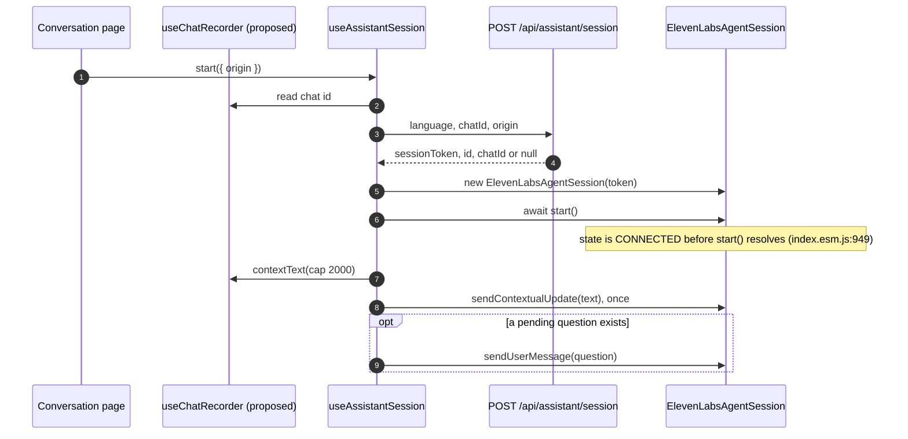
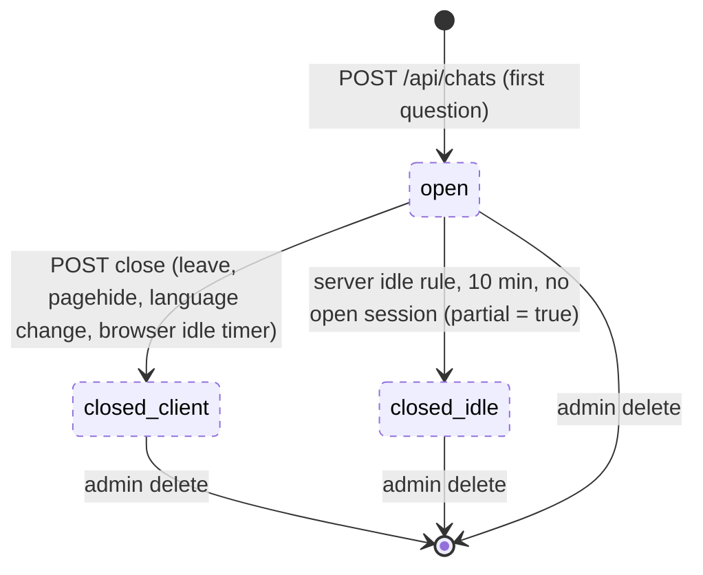
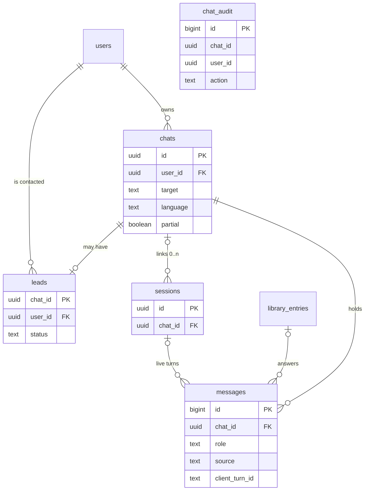

# Chat and message storage

| Field   | Value                                          |
| ------- | ---------------------------------------------- |
| Created | 2026-11-05                                     |
| Updated | 2026-11-06                                     |
| Status  | Draft                                          |
| Domain  | assistant                                      |
| Targets | mobile, web, admin (the widget is not affected, see section 2) |
| Author  | `koh11-t1-res` (Claude Opus 5.5), mission `20261105-koh11`, team `koh11-t1` |
| Sources | `docs/DECISIONS/0016-chat-and-message-storage.md` (Accepted 2026-11-05), `docs/DECISIONS/0014-conversation-data-retention.md` (amended in part by ADR 0016), Linear KOH-11 |

Code is cited at `main@f40e639`. `.../` means `apps/api/services/orchestrator/`. Frontend paths
start at `apps/frontend/`. "ADR" alone means ADR 0016, cited as `0016:NN`. A line marked
**spec decision** is design this spec adds where the ADR leaves the point open. A line marked
**inference** is a conclusion, not a checked fact.

## 1. Purpose

Today no turn of a conversation reaches the backend. The text lives only in the browser
(`src/features/assistant/types.ts:48-52`) and a new start clears it
(`src/features/assistant/state.ts:75-81`). So staff cannot see what a user asked, which recorded
answer led to a consultation request, or who asked to be contacted. The live agent also starts
each session without the questions the user asked before.

This spec builds ADR 0016. A signed-in user's visit to `/video` or `/audio` becomes one stored
**chat**: every library turn and every live turn, as text, in order. The browser posts the turns.
A tap on «درخواست مشاوره» writes a **lead** with a status. Admins read, search and delete chats in
a new "Chats" screen in the `admin` target. Before the first question, the user agrees to a
consent step. Each live session receives the chat's earlier turns as silent context.

## 2. Scope

**In scope.**

- One append-only migration: the tables `chats`, `messages`, `leads`, `chat_audit`, and a nullable
  `sessions.chat_id` (`0016:105-106`). Section 7.
- Three user routes: open a chat, post turns, close a chat (`0016:194-205`). The change to
  `POST /api/assistant/session`: an optional chat id and an origin (`0016:124-128`). Section 6.
- The chat boundary: one visit, 0 to n live sessions, the close and the server's idle-gap fallback
  (`0016:108-117`, `:203-205`). REQ-019, REQ-058.
- Library turns with source `library` and live turns with source `live` (`0016:129-143`).
- The browser chat log, the poster, the in-session retry, and one quiet notice chosen by the
  status code (`0016:211-227`). Group E.
- Agent corrections (`0016:229-233`). REQ-015, REQ-054.
- The lead table with the statuses `new` and `contacted` (`0016:249-258`). REQ-033, REQ-043.
- The admin viewer: list, filters, search, detail, lead status, delete, delete-only audit
  (`0016:272-295`). Groups D and H.
- Deletion on a user's request, decided by an admin (`0016:299-303`, `:380-383`). REQ-045,
  REQ-095.
- The consent step before the first question (`0016:312-321`). Group F.
- Context to the agent with `sendContextualUpdate` after the SDK state is `CONNECTED`
  (`0016:389-410`). Group G.

**Out of scope.**

- This phase stores no audio, of the user or of the avatar (V0, `0016:174-175`). V1 and V2 need a
  new decision.
- This phase does not change the `widget`. The anonymous embed door stores nothing and the chat
  routes refuse it (ADR item 7, `0016:332-334`). Widget chats wait for the signed-in widget ADR.
- This phase does not match typed or spoken questions to the library. That is the matcher spike.
  The library item already accepts a typed or spoken question (REQ-014), so the matcher needs no
  contract change.
- This phase does not export chats (`0016:279-280`) and does not audit the opening of a chat
  (`0016:283`, `:295`).
- This phase gives the user no chat history screen and no endpoint that returns their chat text
  (`0016:413-414`, `:465`).
- This phase has no retention timer (`0016:299`). A chat stays until an admin deletes it.
- This phase does not send context in persona mode (`0016:421-425`).
- This phase does not change the ElevenLabs agent prompt. The greeting, the request to introduce
  oneself, and whether the agent waits for context live outside this repository
  (`0016:260-261`, `:382-383`, `docs/features/response-caching/SPEC.md:688-689`).
- This phase adds no in-app form for a deletion request (spec decision, REQ-045). A user asks
  through the contact channels the app already shows.
- This phase keeps no in-app record of a refused deletion request. A refusal is answered where
  the request came in (REQ-045). Section 13 lists an in-app record as open for the owner.
- This phase has no in-app way to withdraw consent. A user who wants to stop asks by email, and an
  admin can delete their chats (REQ-045). Section 13 lists it as open for the owner.
- This phase adds no lead status beyond `new` and `contacted` (`0016:464`).
- This phase writes no draft and no library content from a chat (`0016:207-209`, `:467-469`).

## 3. Actors and permissions

| Actor | Door | What they can do |
| ----- | ---- | ---------------- |
| Signed-in user on `mobile` or `web` | `get_current_user` (`.../src/auth/dependencies.py:50-54`): the `kd_session` cookie on web, `Authorization: Bearer` on native | open, post to and close **their own** chats; start a session linked to their own open chat. No route returns chat text to them |
| Admin in the `admin` target | `require_admin` (`.../src/auth/dependencies.py:57-61`) as a router dependency, the pattern of `.../src/library/router.py:39` | list, search and read every chat, change a lead's status, delete chats, delete all chats of a user on their request |
| Anonymous widget visitor | embed key plus an allowed `Origin` (`.../src/assistant/router.py:39-54`) | nothing new. The chat routes use `get_current_user`, so the embed key alone gets `401`. A session it starts is never linked to a chat (REQ-032) |

A disabled account gets `403 account_disabled` on every route that resolves the user
(`.../src/auth/dependencies.py:45-46`). The roles stay `user` and `admin` (`docs/DATA_MODEL.md:23`).
"The owner" who decides a deletion is any admin (`0016:299-301`).

`RequireAuth` and `RequireRole` on the frontend routes are UX only
(`src/app/admin/router.tsx:12-16`). The backend checks every request.

## 4. User and system flow

### 4.1 A visit on `mobile` or `web`

1. The user opens `/video` or `/audio`. If this signed-in user has no stored agreement to the
   current consent version on this device, the consent step shows in place of Start and the
   suggestions (REQ-070, REQ-072).
2. The user agrees. Start and the suggestions show. Nothing is written yet: a visit with no
   question writes no chat (`0016:109-110`).
3. The user taps a suggestion (the first user turn of the visit). When the MP4 download succeeds (`src/features/answer-library/useRecordedAnswer.ts:172-180`),
   the browser opens a chat with `POST /api/chats`, then posts the library turn. The server copies
   the entry's question and answer as two messages (REQ-014).
4. The answer ends and the lead card shows. The user taps «درخواست مشاوره». The browser starts a
   session with the open chat's id and origin `lead_card`. The server links the session to the chat
   and writes a lead with status `new` (REQ-032, REQ-033).
5. The SDK `start()` resolves. The browser sends the chat's earlier turns once with
   `sendContextualUpdate` (REQ-080).
6. Live turns from the deduplicated transcript are posted in batches with source `live` (REQ-053).
7. The user presses End, then Start again. The new session carries the same chat id (origin
   `start`), so the chat holds both sessions (`0016:110-111`).
8. The user leaves the screen. The browser flushes the queue and sends `POST /api/chats/{id}/close`
   (REQ-058). If that never arrives, the server closes the chat after the idle gap and sets
   `partial` (REQ-019).

A plain Start before any question has no chat id. The agent's greeting is held in the browser and
not posted. The first user turn (spoken or typed) opens the chat with the session id, the server
links the session then, and the held greeting goes first (`0016:109`, `:126-127`, REQ-051). A
visit that ends with only the greeting writes no chat.

### 4.2 An admin

1. The admin opens "Chats" in the admin sidebar. The list shows newest first (REQ-091).
2. The admin filters, or searches the message text. The term travels in a request body (SEC-004).
3. The admin opens a chat. The detail shows the user's name and phone, the lead status with its
   control, and every message in order (REQ-093).
4. The admin marks the lead `contacted`, or deletes the chat with a confirmation (REQ-094).

### 4.3 The context step



Caption: the steps after `await start()` are proposed. Today the hook goes straight from
`start()` to attaching the media (`src/features/assistant/useAssistantSession.ts:405-416`).
`useChatRecorder` does not exist yet. A sequence diagram has no dashed style for a participant, so
the "(proposed)" label marks it.

## 5. Behaviour

The requirements are grouped by area. Each group is one scoped PR. The order of merge is A, B, C,
D (backend), then F with E (no chat is written without consent, so E never ships before F), then
G, then H. Section 11 says why.

### Chat lifecycle



Caption: the whole lifecycle is new, so every state is dashed. While `open`, turns are posted and
sessions link to the chat (REQ-012, REQ-032). A closed chat never reopens: a later turn goes to a
new chat (REQ-011, REQ-056). Delete removes the chat in any state (REQ-044).

### Group A: data (migration `007`)

- **REQ-001.** One new migration file, `.../migrations/007_chat_storage.sql`, creates `chats`,
  `messages`, `leads` and `chat_audit` and adds `sessions.chat_id`. It is additive: no existing
  column, constraint or row changes. `007` is the next free number at the base (the folder ends at
  `006_library_entries.sql`). If another migration lands first, this file takes the next free
  number. The columns are in section 7.
- **REQ-002.** `messages` are ordered by an identity id, never by time (`0016:78`). Two turns in
  the same instant keep the order of their insert.
- **REQ-003.** A message's client turn id is unique per chat (`0016:131-132`, section 7). A resent
  turn is a duplicate and writes no second row. A library turn's two rows get two derived ids, the
  item's id plus `:q` for the user row and `:a` for the avatar row (REQ-014).
- **REQ-004.** A message with source `live` must carry a session id and no entry id. A message with
  source `library` must carry an entry id and no session id. The database checks both
  (`0016:132-134`).
- **REQ-005.** `leads.chat_id` is unique and is deleted with its chat (`0016:251-252`).
- **REQ-006.** `chat_audit` has no foreign key, so its rows outlive the chat and the user
  (`0016:283-285`).

### Group B: the user chat routes

- **REQ-010.** `POST /api/chats` opens a chat for the caller. The body names the target (`mobile`
  or `web`), the language of the first turn (`fa` or `en`), the consent version, and optionally a
  session id. With a session id, the server links that session to the new chat in the same
  transaction with one conditional statement: `UPDATE sessions SET chat_id = $chat WHERE id = $1
  AND chat_id IS NULL AND metadata->>'principal' = $principal` plus REQ-013's open rule
  (`status = 'TOKEN_ISSUED'` and within its length plus 300 s), the caller rule of
  `.../src/assistant/service.py:225-229`. Zero rows updated means `422 chat_session_invalid`: the
  transaction rolls back, so no chat is created. Two opens racing for one session cannot both win. The
  server cannot prove the target (`0016:127-128`); it stores what the browser sends.
- **REQ-011.** Every route on `/api/chats/{id}` loads the chat and applies the idle rule (REQ-019)
  first. A chat that does not exist, or belongs to another user, answers `404 not_found` with the
  same body (the rule of `.../src/assistant/service.py:227-229`). A closed chat answers
  `409 chat_closed`, `retryable: false`, on the messages route. The close route answers `200` for a
  closed chat (REQ-018).
- **REQ-012.** `POST /api/chats/{id}/messages` takes 1 to 20 items. The batch is written as a
  whole or not at all, in one transaction under a per-chat row lock (`SELECT ... FOR UPDATE` on the
  chat). An item whose client turn id the chat already holds (for a library item, its `:q` id), or
  that repeats an earlier item of the same batch, is dropped and counted in `duplicates`. A duplicate is never an
  error, so a resent batch is safe. This is the pattern of the answers route (`docs/API.md:225-228`).
- **REQ-013.** A `live` item names a session. The server accepts it only when that session's
  `chat_id` is this chat and the session is open. "Open" is the rule the answers route uses today:
  status `TOKEN_ISSUED` and not older than its length plus 300 seconds
  (`.../src/assistant/service.py:233-235`). Any other session answers
  `422 chat_session_invalid`, and nothing of the batch is written. This includes another user's
  session, a session of another chat, and a closed or expired session.
- **REQ-014.** A `library` item names a library entry and an input kind. The server writes it only
  for a servable entry, the same check as playback (`.../src/library/router.py:114-116`,
  `.../src/library/service.py:374-376`), else `422 chat_entry_not_servable`. It writes two
  messages, both source `library`, same entry id, with the derived client turn ids of REQ-003
  (`{clientTurnId}:q` and `{clientTurnId}:a`). The item is a duplicate when `:q` exists:
  1. role `user`: for input kind `tapped`, the entry's `question`, copied by the server; the item
     must not carry `text` (a closed body, `422`). For `typed` or `spoken`, the item must carry
     `text`, the user's own words, and that is what is stored (`0016:136-143`).
  2. role `avatar`: the entry's `answer_text`, copied by the server (at most 480 characters,
     `.../migrations/006_library_entries.sql:14`).

  The texts are server facts. That the play happened is client-reported (`0016:142`).
- **REQ-015.** A `correction` item names a live session and the client turn id of an avatar
  message, with the corrected text (`0016:229-233`). If that message exists and was never
  corrected, the server replaces its text and sets `corrected_at`. If it was corrected before, the
  item is a duplicate. If the message does not exist (its first post was lost), the server inserts
  it with the corrected text and sets `corrected_at` (spec decision: the stored text then matches
  what the user heard; a late original with the same turn id becomes a duplicate). A correction is
  never an admin edit, so REQ-046 holds.
- **REQ-016.** Limits, checked before anything is written:
  - `text`: 1 to 4000 characters after trimming, else `422 validation_error` (spec decision: a
    long agent answer of two or three minutes fits; a library turn is at most 780 characters,
    `0016:140-141`).
  - Messages per chat: at most 500 rows. A batch that would pass 500 after duplicates are dropped
    answers `413 chat_full`, `retryable: false`, and writes nothing (spec decision: 500 rows is far
    above a real visit, since a visit also hits the session rate limit of 20 an hour,
    `.../src/config.py:79`). A library item counts as two rows.
- **REQ-017.** The body of the messages route and of the close route may carry `partial: true`.
  It sets `chats.partial`, which never goes back to `false` (`0016:226`).
- **REQ-018.** `POST /api/chats/{id}/close` sets `ended_at` and `closed_by = 'client'`, and takes
  `partial` as in REQ-017. Closing a closed chat answers `200` again and changes nothing except
  that `partial: true` is still applied (a late close may carry news of a lost turn).
- **REQ-019.** The idle rule. A chat is closed by the server when it is open, its
  `last_activity_at` is 10 minutes old or more, and no session linked to it is open (REQ-013's open
  rule). The server then sets `ended_at = last_activity_at + 10 minutes`, `closed_by = 'idle'`
  and `partial = true` (`0016:204-205`: the server "sets `partial` when no close came").
  `last_activity_at` is set when the chat opens, on every accepted write, and when a session links
  to it. There is no timer: the rule runs as one `UPDATE` at the start of every chat route
  (REQ-011), of `POST /api/assistant/session` with a chat id (REQ-032), and of the admin search and
  detail (REQ-041, REQ-042). So every reader sees the same state. **Spec decision, the gap value:**
  10 minutes. Why: the library turn is posted when the download succeeds, before playback
  (step 3 of section 4.1). The longest wait before the lead card tap is then the longest video
  plus the time to read the card. An answer is at most 480 characters
  (`.../migrations/006_library_entries.sql:14`). Inference: at a slow 8 characters a second of
  Persian speech that is 60 seconds. (The render sprint's average, about 35 seconds, is an average
  only, `docs/features/response-caching/SPEC.md:784-785`.) Ten minutes covers that many times over, and it is short enough
  that a user who comes back much later starts a new chat.
- **REQ-020.** Two rate limits, each counted before the chat lookup, the pattern of
  `.../src/assistant/router.py:105-115`, with new settings next to the others in
  `.../src/config.py:79-85`:
  - the messages route: key `chat_messages:user:{id}`, `CHAT_MESSAGES_RATE_LIMIT_PER_HOUR`, default
    1800;
  - open and close together: key `chat:user:{id}`, `CHAT_RATE_LIMIT_PER_HOUR`, default 120.

  Over a limit: `429 chat_rate_limited`, `retryable: true`, `details.retryAfterSeconds`, and the
  `Retry-After` header (`retry_after_header=True`, `.../src/errors.py:58-69`). **Spec decision, the
  numbers** (inference: the turn rate is not measured). The batch rule (REQ-055) flushes 500 ms
  after the last turn, so turns more than 500 ms apart each go alone. Take a fast live exchange as
  one turn every 3 seconds, both speakers together: 3600 / 3 = 1200 requests an hour, one per turn.
  Corrections and library turns add a few. 1800 is that plus half again. Live time is also bounded:
  at most 20 session mints an hour (`.../src/config.py:79`). Open and close: a visit opens one chat,
  sometimes two (REQ-056 reopen), and closes each, so 120 an hour covers 30 or more visits. The
  limiter is a fixed one-hour window (`.../src/coordination.py:48-59`), so `Retry-After` can be up
  to 3600 seconds (REQ-056 caps the wait).
- **REQ-021.** The chat routes resolve the caller with `get_current_user` only. A request with
  only `X-Embed-Key` gets `401 unauthorized` (`0016:333`).
- **REQ-022.** No user route returns message text. `POST /api/chats` returns the id and the start
  time, the messages route returns counts, the close route returns a status (`0016:413-414`).

### Group C: the session start contract

- **REQ-030.** The body of `POST /api/assistant/session` (today only `language`,
  `.../src/schemas.py:227-228`) gains `chatId` (optional uuid) and `origin` (optional, `start` or
  `lead_card`, default `start`; spec decision: optional, so a client that sends only `language`
  keeps working). Any other `origin` value answers `422 validation_error` and starts nothing
  (`0016:128`). The body stays open to unknown keys, as today, so an old client keeps
  working.
- **REQ-031.** The server stores the origin in `sessions.metadata.origin` for every new session,
  the widget's included (always `start` there). Spec decision: the existing `metadata` jsonb
  (`.../migrations/001_initial.sql:19`) holds it, so no column is added beyond the ADR's.
- **REQ-032.** With a `chatId` and a signed-in caller, the server applies the idle rule to that
  chat, then links the new session to it when the chat is the caller's and open. The link is
  written with the session row (`.../src/assistant/service.py:122-141`) and sets
  `last_activity_at`. When the chat is missing, another user's, or closed, the session still starts,
  unlinked, and the response says `chatId: null` (spec decision: ADR item 3 says a failed write
  never blocks a question, `0016:211`; a refused start would block one). An embed caller's
  `chatId` is ignored and the response says `chatId: null`.
- **REQ-033.** The lead. When a session whose origin is `lead_card` links to a chat (REQ-032, or
  REQ-010 with a session id), the server inserts a `leads` row with status `new` in the same
  transaction, if the chat has no lead yet. A second lead card session in the same chat changes
  nothing (spec decision: the ADR writes "one lead row when the first such session links",
  `0016:251`). The lead is what the client reported (`0016:257-258`).
- **REQ-034.** The response gains `chatId: string | null`: the chat the session is linked to. It is
  `null` with no `chatId` in the request, for a refused link, and for every widget session.

### Group D: the admin API

- **REQ-040.** All admin chat routes sit on one router with
  `dependencies=[Depends(require_admin)]`, registered in `.../src/main.py` next to the others
  (`:214-219`).
- **REQ-041.** `POST /api/admin/chats/search` returns one page of chats, newest first (`started_at`
  descending, then `id`). Filters, all optional and combined with AND: a start date range on
  `started_at` (`from` and `to`, ISO dates `YYYY-MM-DD`, both inclusive, read as UTC days; spec
  decision: the server stores no admin time zone, so a chat late in a Tehran evening can fall on
  the next UTC day), `userId`, `language`, `lead` (`new`, `contacted`, or
  `none` for a chat with no lead), `partial`, and `q`. `q` is 2 to 100 characters, matched as a
  case-insensitive substring of any message text of the chat (`ILIKE` with `%`, `_` and `\`
  escaped). **Spec decision, Persian folding:** the term and the compared text are both folded in
  the query, never in storage, so the stored text stays what the user saw: Arabic `ي` (U+064A)
  becomes `ی` (U+06CC), Arabic `ك` (U+0643) becomes `ک` (U+06A9), and ZWNJ (U+200C) is removed. In
  SQL: `translate(text, 'يك', 'یک')` with `replace(..., U&'\200C', '')`, the same function on `q`.
  Cost: this is a scan of every message of the chats that pass the other filters, with no index,
  and with no retention the table only grows. Inference: at a few hundred thousand messages the
  search still answers in well under a second on one Postgres; past a few million rows it needs a
  trigram index (`pg_trgm`) on the folded text. `pg_trgm` is a new Postgres extension, so it is an
  owner decision, listed in section 13, and not part of this build. Paging is `page` (from 1) and `pageSize` (1 to 100, default 20), with `total`, the
  repo's convention (`docs/API.md:15`). A list item carries no message text (SEC-006).
- **REQ-042.** `GET /api/admin/chats/{id}` returns the chat, the user (`id`, `firstName`,
  `lastName`, `phone`, `status`, the fields `GET /api/admin/users` already shows, `0016:275-276`),
  the lead or `null`, and every message ordered by id. A message carries its role, text, input
  kind, source, session id, entry (`id` and staff `question`, or `null`), `corrected` and its
  insert time. A chat holds at most 500 messages (REQ-016), so the detail is bounded and not paged.
  Missing chat: `404 not_found`.
- **REQ-043.** `PATCH /api/admin/chats/{id}/lead` with `{ "status": "new" | "contacted" }` sets the
  status, `status_changed_at` and `changed_by` (the admin). Back to `new` is allowed, to undo a
  wrong mark (`0016:255-256`). The same status again answers `200` and changes nothing. A chat with
  no lead, or no chat, answers `404 not_found`. It writes no audit row (`0016:287-288`). Two admins
  changing one lead at once: the last write wins, and `changed_by` names that admin. Spec decision:
  there are two statuses and an undo is one click, so a version guard would cost more than the
  mistake it prevents.
- **REQ-044.** `DELETE /api/admin/chats/{id}?reason=admin|user_request` (default `admin`) deletes
  the chat. Its messages and its lead go with it (`ON DELETE CASCADE`), and the linked sessions'
  `chat_id` becomes `NULL`. In the same transaction it writes one `chat_audit` row: action `delete`
  for `admin`, `delete_on_request` for `user_request`, with the admin id, chat id, user id and
  time, no text (`0016:281-283`). Answer `204`. Missing chat: `404 not_found`. An open chat can be
  deleted; the browser's next post then gets `404` and opens a new chat (REQ-056).
- **REQ-045.** `POST /api/admin/users/{userId}/chats/delete` (no body) carries out an admin's
  decision to grant a user's deletion request (`0016:301-302`, `:380-383`). It deletes every chat
  of that user as REQ-044 does, with one `delete_on_request` audit row per chat, in one
  transaction. Answer `200 { "deleted": n }`, `n` may be 0. Unknown user: `404 not_found`.

  **Spec decision, how a request arrives:** the user asks through the contact channels the app
  already shows (`src/features/answer-library/contactChannels.ts:31-33`, the email
  `info@kohansystemfarda.com`), and the consent text says so (REQ-071). An in-app form would need a
  request table and a user screen, which the ADR does not list.

  **How a refusal is recorded (contract item 6):** not in the app in this build. The admin answers
  the request where it came in, for example in the reply to the user's email. Why: the owner limited
  the audit to deletes (`0016:281-283`, `:295`, `:436`), so `chat_audit` holds deletes only, and a
  refusal is not a delete. Section 13 lists an in-app record of refusals as open for the owner.
- **REQ-046.** No admin route edits a message (`0016:278-279`). No route exports chats.
- **REQ-047.** A `disabled` user's chats stay as they are and stay readable, searchable and
  deletable by an admin. The user cannot add to them: every chat route answers
  `403 account_disabled` (`.../src/auth/dependencies.py:45-46`, `0016:380-381`).

### Group E: the browser chat log and poster (`mobile`, `web`)

- **REQ-050.** Where the code lives. A new entity `src/entities/chat/` holds the Zod schemas
  (`types.ts`), the API calls (`api.ts`) and the admin query hooks with a `chatKeys` object
  (`hooks.ts`). A new feature `src/features/chat/` holds `useChatRecorder` (the chat log, the
  poster, the notice), `chatPoster.ts` (the queue, the pattern of
  `src/features/assistant/answerReporter.ts`) and `contextText.ts` (the pure formatter of REQ-082).
  The two pages call `useChatRecorder`, the owner. `useConversationScreen`
  (`src/features/assistant/useConversationScreen.ts:70-95`) is the pass-through: it takes the
  recorder as an option and hands it to `useAssistantSession`. The pages hand it to
  `useAnswerLibrary` directly. The widget's `AssistantPanel` passes nothing, so it records
  nothing (REQ-086).
- **REQ-051.** The chat opens on the first user turn of the visit: a library tap (REQ-052), or a
  typed or spoken live user turn (REQ-053). **Spec decision** (`0016:109`: "a visit with no question
  writes no chat"; `:126-127`: "the first turn posted for it opens the chat"): live avatar turns
  that come before any user turn, such as the agent's greeting, are held in the poster queue, not
  posted. When the first user turn arrives, the chat opens and the held turns are posted first, in
  their order. If the session that produced held turns ends before any user turn, its held turns
  are discarded: they are not posted and do not set `partial`, because a visit with only a
  greeting is not a chat. The open request carries `target` from `env.appTarget` (`mobile` or `web`),
  `language` from the screen (`src/features/assistant/useConversationScreen.ts:73-76`), the stored
  consent version, and, when the first user turn is live, the backend session id. Turns queued while the
  open request runs wait for it.
- **REQ-052.** A library turn is posted when the MP4 download succeeds
  (`src/features/answer-library/useRecordedAnswer.ts:172-180`), when the server counts the play
  (`0016:138-139`). Item: source `library`, input kind `tapped`, the entry id, and a client turn id
  from `crypto.randomUUID()` (the server derives `:q` and `:a` from it, REQ-003). The chat log gets the suggestion's `question` and `answerText`, the
  texts the user saw.
- **REQ-053.** Live turns come from the deduplicated transcript, not from raw events
  (`src/features/assistant/state.ts:174-192`, `0016:201-202`). Each new turn becomes one item:
  source `live`, the backend session id, the role, the transcript turn id (the provider event id)
  as client turn id, and the text. `TranscriptTurn` (`src/features/assistant/types.ts:48-52`)
  gains `inputKind?: 'spoken' | 'typed'`: `typed` from `sendText`
  (`src/features/assistant/useAssistantSession.ts:498-518`), `spoken` from the transcription and
  agent events (`:305-318`, `state.ts:343-357`). It is set on user turns only (the `input_kind` rule
  in section 7).
- **REQ-054.** When the reducer applies a correction (`src/features/assistant/state.ts:194-216`),
  the poster sends one `correction` item for that turn's id, once.
- **REQ-055.** Batching, the numbers of the answer reporter (`src/features/assistant/answerReporter.ts:4-14`):
  a flush 500 ms after the last queued turn, never held longer than 2 s, at most 20 items per
  request, one request in flight per chat.
- **REQ-056.** Retry and the notice, by outcome (`0016:217-224`). "Notice" means REQ-062.

  | Outcome | Poster | Notice |
  | ------- | ------ | ------ |
  | No response, timeout, `5xx` | Retries the same batch after 1 s, 3 s and 10 s (four attempts in all). While `navigator.onLine` is false it pauses and resumes on the `online` event, without counting an attempt. The pause has no time bound: the queue is bounded by the chat's 500-row cap (REQ-016, at most about 2 MB of text), and the chat ends at leave or the idle timer; a chat that ends while still offline drops its queue, and the server's idle rule sets `partial` | after the fourth attempt fails: `chat.save.incomplete`; the batch is dropped and `partial` is set |
  | `429` | Waits `details.retryAfterSeconds` (or `Retry-After`, or 2 s when neither is given), then retries; the wait counts as one of the four attempts. A wait over 30 s is not honoured: the batch is dropped at once and `partial` is set | the same as the row above, when the attempts run out or the wait is over 30 s |
  | `401` | Stops all chat writes for this visit | `chat.save.signedOut` |
  | `403` | Stops all chat writes for this visit | `chat.save.notAllowed` |
  | `404 not_found` or `409 chat_closed` | Opens a new chat once for this batch (REQ-051, with the open session's id if one is open) and sends the batch to it | nothing; if the reopen or the resend fails, the row of that failure applies |
  | `413`, `422` | Splits the batch and sends each item alone, once; an item refused again is dropped and `partial` is set; the others are kept | `chat.save.messageDropped` |
  | `422 chat_consent_required` on the open (this row wins over the one above) | Clears this user's stored agreement; writes nothing more this visit; the consent step shows at the next visit | `chat.save.notAllowed` |
  | `422 chat_session_invalid` on the open (the session ended before its first turn was posted) | Opens again once without the session id; that session's live turns are then refused and dropped, and `partial` is set | `chat.save.messageDropped` |

  Spec decision on the numbers: three retries with growing waits cover a short network drop
  inside a session, and the 10 s last wait stays below one live answer. The 30 s cap on a `429`
  wait (inference): it keeps the retry inside the session, since a sandbox session lasts 60 s
  (`.../src/assistant/service.py:29`), and it is far under the one-hour window, where a long wait
  means the limit is really spent. A `2xx` whose body fails
  the schema counts as written, as the answer reporter does (`answerReporter.ts:38-40`).
  In every row the conversation goes on and the live session is not touched (`0016:226-227`).
- **REQ-057.** Every dropped turn sets a local `partial` flag. The next batch that succeeds, or the
  close, carries `partial: true` (`0016:226`).
- **REQ-058.** The browser closes the chat when: the page unmounts (a route change, which includes
  `/video` to `/audio`, `0016:112-115`), on `pagehide`, on a language change (REQ-063), and when
  its own idle timer fires (10 minutes, REQ-019's value, with no new turn and no live session
  open). Close first flushes the queue, waiting at most 10 s in total (the answer reporter's
  `FINISH_DEADLINE_MS`, `answerReporter.ts:13-14`), then sends `POST /api/chats/{id}/close` with
  `partial`. On `pagehide` the request may never leave the page (`0016:203-205`); the server's idle
  rule then closes the chat. Spec decision, the browser timer: without it, a user who waits 10
  minutes on the screen would get a chat marked `partial` with nothing lost.
- **REQ-059.** Live turns are flushed before the session closes, because the server refuses a turn
  of a closed session (REQ-013). In `releaseSession`, the chat poster's flush for that session runs
  after `answerReporter.finish()` and before `closeAssistantSession`
  (`src/features/assistant/useAssistantSession.ts:208-219`), inside the same 10 s bound.
- **REQ-060.** `start()` gains `{ origin }`. Start passes `start`; «درخواست مشاوره» passes
  `lead_card` (`src/features/answer-library/useAnswerLibrary.ts:71-80`, which already knows the
  difference, `:39`). `createAssistantSession` (`src/features/assistant/useAssistantSession.ts:360-362`)
  sends the open chat's id, if any, and the origin. When the response says `chatId: null` while the
  browser had a chat, the poster treats it as the `409` row: the first live turn opens a new chat
  with that session id.
- **REQ-061.** The chat log is React state inside `useChatRecorder`, one per screen. Each entry has
  the client turn id, role, text, input kind, source and entry id. Failed writes stay in the log,
  so the agent hears what the user saw (`0016:412-414`). The log is cleared when the chat ends.
- **REQ-062.** The notice. At most one per chat is shown (`0016:212-213`). The first outcome that
  calls for one shows it. **Spec reading of `0016:212-213`** ("at most one quiet notice per
  chat"): one notice is shown at a time, but it may change. A later `chat.save.signedOut` or
  `chat.save.notAllowed` replaces an earlier notice in the same place, because saving has then
  stopped for good and the user should know it; nothing replaces those two, and no other notice
  replaces anything. It is the shared `InlineAlert` with `status="warning"`,
  which already sets `role="status"` (`src/shared/ui/InlineAlert.tsx:38-41`), with a Dismiss button
  (`chat.save.dismiss`) passed as its `actions`. On both pages it sits
  under the controls, in normal flow, so it never covers the stage and never moves the Start
  button. It is not an `ErrorState` and it does not end anything.
- **REQ-063.** A chat records the language of its first turn (`0016:119-120`). **Spec decision:** a
  language change while a chat is open closes it, and the next question opens a new chat. Today
  the only language control on `mobile` and `web` is on `/settings` and `/login`
  (`src/pages/settings/SettingsIndexPage.tsx:98`, `src/pages/login/LoginPage.tsx:63`), so reaching
  it leaves the screen and ends the chat anyway. The rule keeps one language per chat if a control
  is ever added to the screen.
- **REQ-064.** The recorder posts nothing while the signed-in user has no stored agreement for the
  current consent version (REQ-072, `0016:319-320`).
- **REQ-065.** `mobile` only: the native app going to the background and coming back.
  Inference, not checked on a device: a route change and `pagehide` do not fire when the app goes
  to the background, and JavaScript timers stop there, so the REQ-058 timer cannot run. A new
  adapter, `src/shared/platform/appLifecycle.ts` (`AppLifecycleService` with
  `onBackground(listener): () => void` and `onForeground(listener): () => void`, exported from
  `src/shared/platform/index.ts`), tells the recorder when the app leaves and comes back. Feature
  code never imports Capacitor for this. The adapter fires only when `isNative()`
  (`src/shared/platform/index.ts:14-16`) is true, on `document.visibilityState` becoming `hidden`
  and then `visible`. Inference, not checked on a device: the Android and iOS WebViews report
  `hidden` when the app pauses. The exact signals are the `pause` and `resume` events of
  `@capacitor/app`, which is not a dependency today (`apps/frontend/package.json:36`); adding it is
  a new dependency, so section 13 lists it for the owner. On web the adapter does nothing: a tab
  switch is not leaving the screen.
  - On background: the recorder **flushes the queue only** and sends no `close` (leader decision,
    turn 3). Why: a short app switch between a recorded answer and the lead card tap must not split
    the chat, or the lead would land in a new chat without the library turn before it
    (`0016:115-116`, `:256-257`). It notes the time it went away.
  - On resume: if the app was away for at least the idle gap (10 minutes, REQ-019) and no live
    session is open, the recorder treats the chat as closed: it sends `close` (best effort) and the
    next user turn opens a new chat (REQ-051). If it was away less, the chat goes on, and the
    REQ-058 timer restarts from the last turn.
  - A killed app sends nothing more. The server's idle rule closes the chat (REQ-019).

  What `partial` means on `mobile`: when the app stays away 10 minutes or more, or is killed, the
  server's idle rule closes the chat and sets `partial`, even when nothing was lost (the rule runs
  first on any request, REQ-011, so a late `close` finds it already closed). So on `mobile` a
  `partial` chat is "not confirmed complete", not "turns were lost". The admin hint says so
  (`chats.partialHint`).

### Group F: the consent step (`mobile`, `web`)

- **REQ-070.** On `/video` and `/audio`, when the signed-in user has no stored agreement for the
  current version (REQ-072),
  the consent step shows in place of the Start button and the suggestion list. It is a HeroUI
  `Card` in the page body, before any question (`0016:318-319`). Nothing else of the page changes.
  Spec decision, placement: the conversation screens, not onboarding, because users who already
  finished onboarding must see it too, and it is next to the action it is about.
- **REQ-071.** The text names everything the ADR lists (`0016:314-319`), in this order. The copy is
  in section 8.
  1. the chat is saved as text: questions, the recorded answers played, and the assistant's words;
  2. spoken turns are kept as text, and no audio is kept;
  3. staff can read saved chats;
  4. the earlier turns of the chat, recorded answers included, go to the live assistant's speech
     provider;
  5. a «درخواست مشاوره» request is recorded so staff can contact the user;
  6. the user can ask for deletion through the contact email, and an admin decides.

  Spec decision: no line about drafts shown to others after review. ADR 0014's sentence
  (`0014:79-80`) covers drafts, and no draft is built. The spec that builds drafts adds its line and
  raises the version (REQ-074).
- **REQ-072.** The agreement is stored per user, not per device, so that another user on the same
  device is asked too. The
  settings slice, which is already saved to `localStorage` (`src/app/store.ts:30`,
  `src/features/settings/settingsSlice.ts:7`), gains `chatConsent`: a map from user id to the
  agreed version. The page reads the user id from the `me` query (`useCurrentUser`,
  `src/entities/user/hooks.ts:17`). "I agree" writes `chatConsent[userId] = CHAT_CONSENT_VERSION`.
  So user B on user A's device sees the consent step. Then Start and the suggestions show and
  focus moves to Start. A user id and a version string are not credentials, so `localStorage` is
  allowed (SEC-012). Logout does not clear the map: the next sign-in of the same user on this
  device needs no second agreement. Accepted trade-off: the map is never pruned, so on a shared
  device `localStorage` lists the ids of the accounts that agreed there.
- **REQ-073.** "Not now" shows the declined view: one line that questions are off because every
  question is saved, the contact card of the lead card (`response-caching` REQ-076), and a
  "Review again" button that shows the consent step again. No Start, no suggestions. The decline
  is React state for this visit only; the next visit asks again.
- **REQ-074.** One version string, `CHAT_CONSENT_VERSION`, today `2026-11-05`, exists in the
  frontend (`src/features/chat/consent.ts`) and in the backend (a constant next to the chat
  service). `POST /api/chats` refuses any other value with `422 chat_consent_required`
  (REQ-010). Changing the text means raising both in the same PR.
- **REQ-075.** **Open, with a safe default.** Whether a user who declines may still play library
  answers, unstored, is open in the ADR (`0016:320-321`). The default here: no. A decliner gets
  neither the library nor a live session on these screens. The ADR asks only about the library;
  the spec applies the same default to a live question, because a live question is a question too
  and would otherwise be the one unstored path. Why "no": it writes nothing and sends nothing that
  the consent covers, and allowing it later is a small UI change, while the reverse would have
  stored or sent data without agreement. The owner (and counsel for any legal limit) decides both.

### Group G: context to the agent

- **REQ-080.** The hook point. In `start()`, right after `await session.start()` resolves and the
  `abandoned()` check passes (`src/features/assistant/useAssistantSession.ts:405-410`), before the
  media is attached. The SDK sets its state to `CONNECTED` as the last step of `start()`
  (`@heygen/liveavatar-web-sdk` 0.0.18, `lib/index.esm.js:949`), and every agent command throws
  before that (`:1383-1388`, `:1434-1438`). When the session is an `ElevenLabsAgentSession`
  (`elevenLabsRef.current` is set, `:391-396`) and the context text is not empty, the browser calls
  `sendContextualUpdate(text)` once, then `sendUserMessage(question)` when a pending question
  exists. Today no caller passes a pending question; the matcher will. Why this point and not the
  `SESSION_STATE_CHANGED` handler (`:236-238`): the event fires inside `start()` at the same moment
  (the state setter emits it, `index.esm.js:1248-1253`), and the start path already runs once per
  session and has the abandon check, so it needs no extra "sent once" flag.
- **REQ-081.** Never on the app's first `connected`, which usually comes from the stream-ready event
  before `start()` resolves (`useAssistantSession.ts:245-250`, `0016:392-395`).
- **REQ-082.** The text format (`0016:403`), plain text, oldest first:

  ```text
  Earlier in this conversation (oldest first):
  User (tapped, recorded answer): {text}
  Assistant (recorded answer): {text}
  User (spoken, live): {text}
  Assistant (live): {text}
  ```

  `{text}` stands for the turn's text. One line per turn. The labels are English, since the agent reads them and the user never sees
  them; the turn text stays as it was, Persian included. Line breaks inside a turn become spaces.
- **REQ-083.** The cap is 2000 characters for the whole text, header included. Turns are kept from
  the newest backwards while they fit whole; older turns are dropped. When the newest turn alone
  does not fit, its text is cut to fit and ends with `…`. **Spec decision, the value:** two full
  library turns (2 × 780 characters, `0016:406`) plus labels fit, which is the owner's example
  (two library answers, then a live question, `0016:16-19`). The command travels as UTF-8 JSON
  over a LiveKit data packet (`lib/index.esm.js:1311-1320`); Persian is two bytes a character, so
  2000 characters stay near 4 KB, well under the 15360 bytes livekit-client 2.15.7 sets for its own
  RPC payloads (`dist/livekit-client.esm.mjs:15829`). Inference: that RPC bound is a safe reference
  for one reliable packet; the SDK states no limit for contextual updates. **The cap is not
  measured.** The ADR says the spec measures the size limit before setting it (`0016:405`). That
  needs a live provider session, a paid call, and LiveAvatar is inactive. Section 13 lists the
  measurement as an open item that must be done before Group G ships.
- **REQ-084.** The context holds every turn of the chat log before this session started, earlier
  live sessions included. It never reads the stored chat back (`0016:417-418`).
- **REQ-085.** A throw from either call is caught. Nothing is shown, nothing is retried, nothing is
  written to the console. The conversation goes on. In persona mode (`LiveAvatarSession`, no
  contextual update, `0016:421-425`) no context is sent and earlier turns are never put into
  `message()`. The chat is still stored.
- **REQ-086.** The widget sends no context: its `AssistantPanel` has no chat log.

### Group H: the admin "Chats" screen

- **REQ-090.** Two routes in the admin router (`src/app/admin/router.tsx:25-31`): `chats` and
  `chats/:chatId`, pages under `src/pages/admin/chats/`. A sidebar item "Chats" after "Library"
  (`src/app/admin/AdminLayout.tsx:31-33`).
- **REQ-091.** The list page reuses the users page pattern (`src/pages/admin/users/AdminUsersPage.tsx`):
  HeroUI `SearchField`, `Table` and `Pagination`, 20 rows a page. Filters above the table: a
  `DateRangePicker` for the start date, `Select`s for language, lead status (`new`, `contacted`,
  "no lead", all) and partial (yes, no, all). Columns: started at, user (name, then phone in a
  `dir="ltr"` span), language, messages, lead (a `Chip`), and state (open, closed, a `partial`
  `Chip`). A row opens the detail.
- **REQ-092.** The search field sends `q` 300 ms after the last keystroke, and only from 2
  characters. A change of any filter or of `q` goes back to page 1.
- **REQ-093.** The detail page. A header with the user's name, phone (`dir="ltr"`), a "Disabled"
  `Chip` when the account is disabled, the target, the language, start and end times, and a line
  explaining `partial` when it is set. A lead section (only when a lead exists) with a
  `ToggleButtonGroup` `new` / `contacted` and `chats.detail.leadChanged` ("Last changed by {{name}} at {{time}}"). Then every
  message in order: role, input kind, source (`Chip`; a library message also shows the entry's
  question), the time, and the text. The text is a React text node with `whitespace-pre-wrap`,
  `break-words` and `dir="auto"`, never HTML (SEC-005). A link "All chats of this user" opens the
  list filtered by `userId`.
- **REQ-094.** "Delete chat" opens a HeroUI `AlertDialog` that says the chat, its messages and its
  lead are removed for good, with a `Checkbox` "The user asked for this deletion" (it picks
  `reason=user_request`). Confirm sends REQ-044, then goes back to the list with a success
  `InlineAlert`.
- **REQ-095.** A "Deletion request" section on the detail offers "Delete all chats of this user".
  It opens an `AlertDialog`; confirm sends REQ-045. Then the page goes back to the list with the
  count in a success `InlineAlert`.
- **REQ-096.** The lead control shows `isPending` while its `PATCH` runs and is disabled meanwhile.
  It updates from the response, never before (no optimistic update: a wrong status misleads staff).
- **REQ-097.** Server data is TanStack Query only: `chatKeys.search(filters)`,
  `chatKeys.detail(id)`. Each mutation invalidates the list and that detail. Filters, page and `q`
  are React state in the page.
- **REQ-098.** A delete or a lead change that answers `404` shows `chats.errors.gone` and offers
  the way back to the list, since the chat was deleted meanwhile.

### Security requirements

- **SEC-001.** The user chat routes use `get_current_user`. Another user's chat answers the same
  `404` body as a missing one. The embed key alone gets `401`.
- **SEC-002.** Every `/api/admin/chats/*` route and `/api/admin/users/{userId}/chats/delete` sit on a router with
  `dependencies=[Depends(require_admin)]`. A non-admin gets `403 forbidden`, no session `401`.
- **SEC-003.** Logs carry ids and counts only (`0016:344-347`). The events and their only
  fields: `chat_opened` (`chat_id`, `session_id`), `chat_messages_written` (`chat_id`, `recorded`,
  `duplicates`, `partial`), `chat_closed` and `chat_closed_idle` (`chat_id`, `partial`),
  `lead_created` and `lead_status_changed` (`chat_id`), `chat_deleted` and
  `chat_deleted_on_request` (`chat_id`, `admin_id`). The event name carries the kind, so no field holds a status or an action. Never
  message text, the entry id of a user's turn, a search term, a name, a phone or a consent
  version. A backend test asserts that writing
  messages and searching leave no text, term or phone in any log record. A frontend test asserts
  that the context step and the poster call no `console` method.
- **SEC-004.** No chat route carries user text in its URL. The search term goes in the body of
  `POST /api/admin/chats/search` (`0016:290-293`). Checked: the API runs uvicorn with its default
  access log (`.../Dockerfile:28`); uvicorn 0.35.0, the pinned version
  (`.../requirements.txt:2`), logs `'%s - "%s %s HTTP/%s" %d'` with
  `get_path_with_query_string(scope)` (`uvicorn/protocols/http/h11_impl.py:472-477`,
  `httptools_impl.py:475-480`), which appends the raw query string (`uvicorn/protocols/utils.py:52-56`),
  and `access_log` is on by default (`uvicorn/main.py:490`). The `uvicorn.access` logger keeps its
  own handler and does not propagate in the default `LOGGING_CONFIG` (`uvicorn/config.py:97`), which
  applies because the command passes no `--log-config`, so the app's JSON root handler
  (`.../src/logging.py:15-24`) does not replace it. Source: the PyPI wheel
  `uvicorn-0.35.0-py3-none-any.whl`, SHA-256 `197535216b25ff9b785e29a0b79199f55222193d47f820816e7da751e9bc8d4a`,
  fetched 2026-11-05 (no uvicorn is installed for `apps/api` on this machine). The proxy logs it
  too: the web container is `nginx:1.27-alpine` (`apps/frontend/Dockerfile:17-18`) and
  `infra/nginx/default.conf:1-38` sets no `access_log`, so nginx's default applies. Its documented
  default is `access_log logs/access.log combined;`, and `combined` logs `"$request"`
  (<https://nginx.org/en/docs/http/ngx_http_log_module.html>, fetched 2026-11-05), the full original request line, which
  holds the query string (inference from the `$request` definition, "full original request line",
  <https://nginx.org/en/docs/http/ngx_http_core_module.html#var_request>). Inference: the official image's own `nginx.conf` uses a format with
  `$request` too; the image was not pulled to check. The body design makes all of this
  non-load-bearing: no user text is in any URL.
- **SEC-005.** Message text, names and entry questions render as React text, never through
  `dangerouslySetInnerHTML` or a markdown renderer, and links in them are not made clickable
  (`0016:82`, `:278`).
- **SEC-006.** Explicit allowlists. A search item: `id`, `user` (`id`, `firstName`, `lastName`,
  `phone`), `target`, `language`, `startedAt`, `endedAt`, `messageCount`, `partial`, `closedBy`,
  `lead` (`status` or `null`). The detail adds the messages and the user's `status`. No route
  returns `consent_version`, `last_activity_at`, a session token or any provider field.
- **SEC-007.** Rate limits: REQ-020 for the user chat routes; the session mint limit stays as it is
  (`.../src/assistant/router.py:64-68`). The admin routes have none, like every admin route today;
  `pageSize` and `q` are capped (REQ-041).
- **SEC-008.** Deletion removes the rows from the live database at once. It does not reach backups
  (`0016:303`). `docs/DATA_MODEL.md` says so with the code. The audit row holds no text.
- **SEC-009.** The server checks the consent version the client reports: no chat row exists
  without the current version (REQ-074). **Known limit:** the server cannot prove which person
  agreed, or that anyone did; it trusts the signed-in client, as it trusts the turn text
  (`0016:207-208`). Section 13 lists a server-side consent record as open for the owner.
- **SEC-010.** All new request bodies are closed (`extra="forbid"`, the pattern of
  `.../src/schemas.py:252-266`). A tapped library item that carries `text` is refused, so a client
  cannot put its own words in the server-copied texts.
- **SEC-011.** The text is what the browser reports, in its own chat only (`0016:207-208`). It is
  never a draft and never library content (`0016:467-469`).
- **SEC-012.** No new token. The LiveAvatar session token stays in memory as today
  (`docs/SECURITY.md:23-25`). The only new browser storage is the consent map of REQ-072.
- **SEC-013.** No user route returns a lead or its status (`0016:256`).
- **SEC-014.** A `422` from FastAPI's validation handler returns the error details
  (`.../src/main.py:197-211`). Inference from pydantic v2's default error shape: those details hold
  the rejected input, so a too-long text goes back to the same caller who sent it. No one else sees
  it, and it is not logged. The poster never logs an `ApiError`'s details.

### State ownership

| State | Owner |
| ----- | ----- |
| chats, messages, leads, audit rows | PostgreSQL |
| admin search page, admin detail | TanStack Query (`chatKeys`) |
| the chat log, the open chat id, the queue, `partial`, the notice shown | React state in `useChatRecorder` |
| the transcript, with the new `inputKind` | the reducer of `useAssistantSession`, as today |
| whether this start came from the lead card | React state in `useAnswerLibrary` (`:39`), as today |
| the agreed consent version, per user id | Redux settings slice (`chatConsent`), saved to `localStorage` (REQ-072) |
| a decline in this visit | React state in the page |
| filters, page, `q`, dialog open | React state in the admin page |

No piece of server data is copied into Redux. The chat log is not server data: no endpoint returns
it, and it holds what the user saw, failed writes included.

## 6. API contract

Paths are the public ones. nginx strips `/api` (`infra/nginx/default.conf:6-7`), so the routes are
registered as `/chats/...` and `/admin/chats/...`. Errors use the orchestrator's envelope
(`.../src/main.py:180-194`). JSON is camelCase (`CamelModel`, `.../src/schemas.py:16-21`).

### Signed-in user

**`POST /api/chats`**

```json
{ "target": "mobile", "language": "fa", "consentVersion": "2026-11-05", "sessionId": "uuid" }
```

- `target`: `mobile` or `web`. `language`: `fa` or `en`. `consentVersion`: string. `sessionId`:
  optional uuid.
- `201`: `{ "id": "uuid", "startedAt": "ISO 8601" }`.
- `401 unauthorized`, `403 account_disabled`. `422 validation_error` for a bad or extra field.
  `422 chat_consent_required` for another consent version. `422 chat_session_invalid` when the
  session is not the caller's, not open, or already linked to a chat. `429 chat_rate_limited`.

**`POST /api/chats/{id}/messages`**

```json
{
  "partial": true,
  "messages": [
    { "source": "library", "clientTurnId": "uuid", "libraryEntryId": "uuid", "inputKind": "tapped" },
    { "source": "library", "clientTurnId": "uuid", "libraryEntryId": "uuid", "inputKind": "typed", "text": "user words" },
    { "source": "live", "clientTurnId": "event id", "sessionId": "uuid", "role": "user", "inputKind": "spoken", "text": "..." },
    { "source": "live", "clientTurnId": "event id", "sessionId": "uuid", "role": "avatar", "text": "..." },
    { "source": "correction", "clientTurnId": "event id", "sessionId": "uuid", "text": "corrected words" }
  ]
}
```

- `messages`: 1 to 20 items. `clientTurnId`: 1 to 120 characters, and it must not end in `:q` or
  `:a` (those suffixes are the server's, REQ-003). `text`: 1 to 4000 characters
  after trimming. `inputKind` on a `live` item: required for `role: "user"` (`spoken` or `typed`),
  forbidden for `avatar`. On a `library` item: `tapped`, `typed` or `spoken`; `text` is forbidden
  for `tapped` and required otherwise. A `correction` targets an avatar message. `partial`:
  optional, only `true` has an effect.
- `200`: `{ "recorded": number, "duplicates": number }`. `recorded` counts rows, so a library item
  counts 2; a correction that replaced a text counts 1.
- In the order the checks run: `401`, `403 account_disabled`, `422 validation_error`,
  `429 chat_rate_limited`, `404 not_found`, `409 chat_closed`, `422 chat_session_invalid`,
  `422 chat_entry_not_servable`, `413 chat_full`. Nothing is written on any error.

**`POST /api/chats/{id}/close`**

- Body: `{ "partial"?: true }`. `200`: `{ "status": "closed" }`, also for a chat already closed.
- `401`, `403 account_disabled`, `404 not_found`, `422 validation_error`, `429 chat_rate_limited`.

**`POST /api/assistant/session`** (changed)

- Request: `{ "language"?: "fa" | "en", "chatId"?: "uuid", "origin"?: "start" | "lead_card" }`.
- Response: today's fields (`docs/API.md:159-171`) plus `"chatId": "uuid" | null` (REQ-034).
- New: `422 validation_error` for an `origin` outside the list. A refused link is not an error
  (REQ-032). Every other status is unchanged.

### Admin (`require_admin`)

**`POST /api/admin/chats/search`**

```json
{ "from": "2026-11-01", "to": "2026-11-05", "userId": "uuid", "language": "fa",
  "lead": "new", "partial": false, "q": "term", "page": 1, "pageSize": 20 }
```

- Every field optional. `lead`: `new`, `contacted` or `none`. `q`: 2 to 100 characters.
  `pageSize`: 1 to 100, default 20.
- `200`: `{ "items": ChatSummary[], "total": number, "page": number, "pageSize": number }`, where
  `ChatSummary` is the SEC-006 allowlist plus `isOpen`.
- `401`, `403 forbidden`, `422 validation_error`.

**`GET /api/admin/chats/{id}`**

- `200`: `{ "chat": ChatSummary, "user": { "id", "firstName", "lastName", "phone", "status" },
  "lead": { "status", "createdAt", "statusChangedAt", "changedBy": { "id", "firstName", "lastName" } | null } | null,
  "messages": [{ "id": number, "role", "text", "inputKind", "source", "sessionId", "entry": { "id", "question" } | null, "corrected": boolean, "createdAt" }] }`.
- `401`, `403 forbidden`, `404 not_found`.

**`PATCH /api/admin/chats/{id}/lead`**

- Body: `{ "status": "new" | "contacted" }`. `200`: the lead object above.
- `401`, `403 forbidden`, `404 not_found` (no chat or no lead), `422 validation_error`.

**`DELETE /api/admin/chats/{id}?reason=admin|user_request`**

- `204`. `401`, `403 forbidden`, `404 not_found`, `422 validation_error` for another `reason`.
- The CORS list has no `DELETE` today (`.../src/main.py:155`), and the admin runs on its own origin
  (`docs/SECURITY.md:15`). The change adds `DELETE` to `allow_methods`.

**`POST /api/admin/users/{userId}/chats/delete`**

- No body. `200`: `{ "deleted": number }`.
- `401`, `403 forbidden`, `404 not_found`, `422 validation_error` for a bad id.

### What changes with the code

`docs/API.md` (the table at `:35-55`, the session section at `:131-198`, and a new chat section),
the Zod schemas in `src/entities/assistant-session/types.ts` and the new `src/entities/chat/types.ts`,
and `src/data/mock/handlers.ts` with the same routes, rules and status codes. No route answers
`202`: every write is one short transaction.

### Deny-cases and their allowed pair

| Rejected | Answer | Closest allowed case |
| -------- | ------ | -------------------- |
| post to another user's chat id | `404 not_found` | the owner posts to their own open chat: `200` |
| post to a closed chat | `409 chat_closed` | the same chat while open: `200` |
| `live` item whose session is another chat's, closed, or expired | `422 chat_session_invalid` | the chat's own open session: `200` |
| `library` item for an entry that is not servable | `422 chat_entry_not_servable` | a servable entry: `200`, two rows |
| `text` of 4001 characters | `422 validation_error` | exactly 4000 characters: `200` |
| a batch that takes the chat to 501 rows | `413 chat_full` | a batch that takes it to exactly 500: `200` |
| a repeated `clientTurnId` in the same chat | `200`, `duplicates: 1`, no row | a new `clientTurnId`: `recorded: 1` |
| a non-admin on any admin chat route | `403 forbidden` | an admin: `200` or `204` |
| `origin: "other"` on session start | `422 validation_error` | `start` and `lead_card`: `200` |
| session start with another user's `chatId` | `200`, `chatId: null`, not linked | the caller's own open chat: `200`, `chatId` equal to it |
| open with another consent version | `422 chat_consent_required` | the current version: `201` |
| `q` of 1 or 101 characters | `422 validation_error` | 2 and 100 characters: `200` |

## 7. Data model and persistence

Migration `007_chat_storage.sql`, applied in order on startup (`.../src/database.py:279-292`).
Additive: four new tables and one new nullable column. There is no downgrade path.



Caption: `chats`, `messages`, `leads` and `chat_audit` are new. `users`, `sessions` and
`library_entries` exist; `sessions.chat_id` is the one new column on them. The tables are not
styled, since GitHub's Mermaid may not apply `classDef` to an `erDiagram`. `chat_audit`
has no relation on purpose (REQ-006). The full columns are in the tables below.

### `chats`

| Column | Type | Rule |
| ------ | ---- | ---- |
| `id` | uuid | primary key, `gen_random_uuid()` |
| `user_id` | uuid | not null, references `users(id)` |
| `target` | text | `mobile` or `web` (`0016:119`) |
| `language` | text | `fa` or `en`, the first turn's |
| `consent_version` | text | not null, the version agreed (spec decision, REQ-074) |
| `started_at` | timestamptz | not null, default `now()` |
| `last_activity_at` | timestamptz | not null, REQ-019 (spec decision) |
| `ended_at` | timestamptz (null) | null while open |
| `closed_by` | text (null) | `client` or `idle` (spec decision: lets an admin tell a clean close from a lost one) |
| `message_count` | integer | not null, default 0, at most 500, kept in the write transaction |
| `partial` | boolean | not null, default `false`, never back to `false` |

Indexes: `(started_at DESC, id DESC)` for the list, `(user_id, started_at DESC)` for the user
filter and REQ-045, and a partial index on `(last_activity_at) WHERE ended_at IS NULL` for the
idle rule.

### `messages`

| Column | Type | Rule |
| ------ | ---- | ---- |
| `id` | bigint | identity, primary key, the order (REQ-002) |
| `chat_id` | uuid | not null, references `chats(id) ON DELETE CASCADE` |
| `role` | text | `user` or `avatar` |
| `text` | text | not null, 1 to 4000 characters |
| `input_kind` | text (null) | `spoken`, `typed` or `tapped`; not null exactly when `role = 'user'` |
| `source` | text | `live` or `library` |
| `session_id` | uuid (null) | references `sessions(id)`; not null exactly when `source = 'live'` |
| `library_entry_id` | uuid (null) | references `library_entries(id)`; not null exactly when `source = 'library'` |
| `client_turn_id` | text | not null, 1 to 122 characters (120 sent, plus a 2-character suffix on library rows) |
| `corrected_at` | timestamptz (null) | REQ-015 |
| `created_at` | timestamptz | not null, `clock_timestamp()` |

Unique: `(chat_id, client_turn_id)`, the ADR's key (`0016:131-132`). A library turn's two rows
carry the derived ids `{id}:q` and `{id}:a` (REQ-003), so they never collide. Index:
`(chat_id, id)`.

Spec decision, `input_kind` on user rows only. The ADR lists the input kind as a message field
(`0016:130-131`) and its values (`spoken`, `typed`, `tapped`) all describe how a user asked. An
avatar row has no input, so its value is null.

A message has no voice reference (`0016:133-134`). Library entries are never deleted (a
withdrawn entry's row stays after its media is gone, `docs/features/response-caching/SPEC.md:809-810`),
and no code in `.../src` deletes a `sessions` or a `library_entries` row, so both foreign keys hold.

### `leads`

| Column | Type | Rule |
| ------ | ---- | ---- |
| `chat_id` | uuid | primary key, references `chats(id) ON DELETE CASCADE` |
| `user_id` | uuid | not null, references `users(id)` |
| `status` | text | `new` or `contacted`, default `new` |
| `created_at` | timestamptz | not null, default `now()` |
| `status_changed_at` | timestamptz | not null, default `now()` |
| `changed_by` | uuid (null) | references `users(id)`; null until an admin changes it |

Index: `(status, created_at DESC)`. This is the ADR's minimum shape (`0016:251-255`) and nothing
more. No entry field: the answer that led to the lead is the `library` turn just before the
session (`0016:256-257`).

### `chat_audit`

| Column | Type | Rule |
| ------ | ---- | ---- |
| `id` | bigint | identity, primary key |
| `admin_id` | uuid | not null, no foreign key |
| `chat_id` | uuid | not null, no foreign key |
| `user_id` | uuid | not null, no foreign key |
| `action` | text | `delete` or `delete_on_request`; both are deletes (`0016:281-283`, `:295`) |
| `created_at` | timestamptz | not null, `clock_timestamp()` |

No text column (`0016:281-283`).

### `sessions.chat_id`

`ALTER TABLE sessions ADD COLUMN IF NOT EXISTS chat_id UUID REFERENCES chats(id) ON DELETE SET NULL`,
with an index on `chat_id`. At most one chat per session, 0 to n sessions per chat (`0016:121-123`).
The provider conversation id stays on the session (`0016:123-124`). The origin goes in
`sessions.metadata.origin` (REQ-031), no column.

### Lifecycle

A chat is written when the first question arrives, closed by the browser or the idle rule, and
kept until an admin deletes it. There is no timer (`0016:299`). `provider_usage` rows are not
joined to messages (`0016:151`). The anonymous usage row of a library play keeps its rule, with no
user id (`docs/DATA_MODEL.md:159-165`); the chat is the separate record (`0016:147-149`).

## 8. Errors and edge cases

### The save notice (`common.json`, `chat.save.*`)

The notice is quiet: it never stops the conversation, and the user's words are never lost from the
screen (the transcript stays). Retrying is not the user's job; the poster already retried.

| Key | When (REQ-056) | `en` | `fa` |
| --- | -------------- | ---- | ---- |
| `chat.save.incomplete` | network, timeout, `5xx`, `429` after the last attempt; a failed reopen | This conversation may not be saved in full. | ممکن است این گفتگو کامل ذخیره نشود. |
| `chat.save.signedOut` | `401` | Your sign-in has ended, so this conversation is no longer saved. | ورود شما به پایان رسیده است، پس این گفتگو دیگر ذخیره نمی‌شود. |
| `chat.save.notAllowed` | `403`, `422 chat_consent_required` | This conversation cannot be saved. | این گفتگو ذخیره نمی‌شود. |
| `chat.save.messageDropped` | `413`, `422` for one item | One message could not be saved. | یک پیام ذخیره نشد. |
| `chat.save.dismiss` | the notice's close button | Dismiss | بستن |

### The consent step (`common.json`, `chat.consent.*`)

| Key | `en` | `fa` |
| --- | ---- | ---- |
| `chat.consent.title` | Before you ask | پیش از پرسیدن |
| `chat.consent.intro` | Please read how we keep this conversation. | لطفاً بخوانید که این گفتگو را چگونه نگه می‌داریم. |
| `chat.consent.saved` | We save this conversation as text: your questions, the recorded answers you play, and what the assistant says. | این گفتگو را به‌صورت متن ذخیره می‌کنیم: پرسش‌های شما، پاسخ‌های ضبط‌شده‌ای که پخش می‌کنید و آنچه دستیار می‌گوید. |
| `chat.consent.noAudio` | What you say out loud is saved as text. No audio is saved. | آنچه با صدا می‌گویید به‌صورت متن ذخیره می‌شود. هیچ صدایی ذخیره نمی‌شود. |
| `chat.consent.staff` | Our staff can read saved conversations. | کارکنان ما می‌توانند گفتگوهای ذخیره‌شده را بخوانند. |
| `chat.consent.provider` | When you talk to the live assistant, the earlier parts of this conversation, recorded answers included, are sent to its speech provider so it knows what you asked. | وقتی با دستیار زنده صحبت می‌کنید، بخش‌های قبلی همین گفتگو، از جمله پاسخ‌های ضبط‌شده، برای ارائه‌دهندهٔ گفتار آن فرستاده می‌شود تا بداند چه پرسیده‌اید. |
| `chat.consent.lead` | If you tap «Request a consultation», we record the request so our staff can contact you. | اگر «درخواست مشاوره» را بزنید، درخواست شما ثبت می‌شود تا کارکنان ما با شما تماس بگیرند. |
| `chat.consent.delete` | You can ask us to delete your saved conversations by email at {{email}}. Our staff decide on each request. | می‌توانید با ایمیل به {{email}} درخواست کنید گفتگوهای ذخیره‌شدهٔ شما پاک شود. کارکنان ما دربارهٔ هر درخواست تصمیم می‌گیرند. |
| `chat.consent.agree` | I agree | موافقم |
| `chat.consent.decline` | Not now | فعلاً نه |
| `chat.consent.declined` | Questions are off, because every question is saved. You can still contact us directly. | پرسیدن خاموش است، چون هر پرسش ذخیره می‌شود. همچنان می‌توانید مستقیم با ما تماس بگیرید. |
| `chat.consent.review` | Review again | دوباره ببینم |

`{{email}}` is filled from `contactChannels.ts`, never typed into the locale file, so the address
lives in one place. The `en` lead line uses the English label of `library.lead.consult`
("Request a consultation").

### The admin screen (`admin.json`, `chats.*`)

| Key | `en` | `fa` |
| --- | ---- | ---- |
| `nav.chats` | Chats | گفتگوها |
| `chats.title` | Chats | گفتگوها |
| `chats.search` | Search message text | جستجو در متن پیام‌ها |
| `chats.clearSearch` | Clear search | پاک کردن جستجو |
| `chats.searchHint` | Type at least 2 characters. | دست‌کم ۲ نویسه بنویسید. |
| `chats.filters.dates` | Started between | شروع‌شده بین |
| `chats.filters.language` | Language | زبان |
| `chats.filters.lead` | Consultation request | درخواست مشاوره |
| `chats.filters.partial` | Saved in full | ذخیرهٔ کامل |
| `chats.filters.all` | All | همه |
| `chats.lead.new` | New | جدید |
| `chats.lead.contacted` | Contacted | تماس گرفته شد |
| `chats.lead.none` | No request | بدون درخواست |
| `chats.columns.started` | Started | شروع |
| `chats.columns.user` | User | کاربر |
| `chats.columns.language` | Language | زبان |
| `chats.columns.messages` | Messages | پیام‌ها |
| `chats.columns.lead` | Request | درخواست |
| `chats.columns.state` | State | وضعیت |
| `chats.state.open` | Open | باز |
| `chats.state.closed` | Closed | بسته |
| `chats.state.partial` | Not saved in full | ناقص ذخیره شده |
| `chats.partialHint` | This chat may be incomplete: some turns may not have been saved, and they cannot be recovered. On the phone app this also shows when the app closed before the chat ended. | این گفتگو شاید کامل نباشد: ممکن است برخی نوبت‌ها ذخیره نشده باشد و بازیابی نمی‌شود. در برنامهٔ گوشی، این برچسب وقتی هم دیده می‌شود که برنامه پیش از پایان گفتگو بسته شده است. |
| `chats.empty` | No chats yet. | هنوز گفتگویی نیست. |
| `chats.emptyFiltered` | No chat matches these filters. | هیچ گفتگویی با این فیلترها پیدا نشد. |
| `chats.loadError` | The chats could not be loaded. | گفتگوها بارگیری نشد. |
| `chats.detail.back` | Back to chats | بازگشت به گفتگوها |
| `chats.detail.userChats` | All chats of this user | همهٔ گفتگوهای این کاربر |
| `chats.detail.disabled` | Disabled account | حساب غیرفعال |
| `chats.detail.leadChanged` | Last changed by {{name}} at {{time}} | آخرین تغییر: {{name}}، {{time}} |
| `chats.detail.role.user` | User | کاربر |
| `chats.detail.role.avatar` | Assistant | دستیار |
| `chats.detail.input.spoken` | Spoken | گفتاری |
| `chats.detail.input.typed` | Typed | نوشتاری |
| `chats.detail.input.tapped` | Tapped a question | انتخاب پرسش |
| `chats.detail.source.live` | Live | زنده |
| `chats.detail.source.library` | Recorded answer | پاسخ ضبط‌شده |
| `chats.detail.corrected` | Corrected by the assistant | اصلاح‌شده توسط دستیار |
| `chats.detail.loadError` | This chat could not be loaded. | این گفتگو بارگیری نشد. |
| `chats.delete.button` | Delete chat | حذف گفتگو |
| `chats.delete.title` | Delete this chat? | این گفتگو حذف شود؟ |
| `chats.delete.body` | The chat, its messages and its consultation request are removed for good. | گفتگو، پیام‌ها و درخواست مشاورهٔ آن برای همیشه پاک می‌شود. |
| `chats.delete.onRequest` | The user asked for this deletion | کاربر این حذف را درخواست کرده است |
| `chats.delete.confirm` | Delete | حذف |
| `chats.delete.cancel` | Cancel | انصراف |
| `chats.delete.done` | The chat was deleted. | گفتگو حذف شد. |
| `chats.request.title` | Deletion request | درخواست حذف |
| `chats.request.deleteAll` | Delete all chats of this user | حذف همهٔ گفتگوهای این کاربر |
| `chats.request.deleteAllBody` | Every saved chat of this user is removed for good. | همهٔ گفتگوهای ذخیره‌شدهٔ این کاربر برای همیشه پاک می‌شود. |
| `chats.request.deleted` | {{count}} chats were deleted. | {{count}} گفتگو حذف شد. |
| `chats.errors.gone` | This chat no longer exists. It may have been deleted. | این گفتگو دیگر وجود ندارد. شاید حذف شده باشد. |
| `chats.errors.actionFailed` | The change was not saved. Try again. | تغییر ذخیره نشد. دوباره امتحان کنید. |

### Edge cases

| Case | Behaviour |
| ---- | --------- |
| The same batch sent twice (retry after a timeout that did write) | Every item is a duplicate: `200`, `recorded: 0` (REQ-012) |
| Two batches of one chat at once (two tabs cannot share a chat; one tab sends one at a time) | The per-chat row lock serializes them (REQ-012) |
| A turn arrives after the session closed | `422 chat_session_invalid`; the poster drops it and sets `partial` (REQ-056). REQ-059 makes this rare |
| The download succeeds and the entry is unpublished before the post | `422 chat_entry_not_servable`; dropped, `partial` |
| The chat goes idle on the server while the tab is alive (the tab slept) | the next post gets `409`; the poster opens a new chat once (REQ-056) |
| Lead card session start races the idle close | the session starts unlinked (`chatId: null`); the first live turn opens a new chat and the lead is written there (REQ-010, REQ-033). The library turn that led to it stays in the old chat. Accepted: rare, and the new chat still shows the request |
| A reload | a new chat; the old one closes by `pagehide` or by the idle rule (`0016:112`) |
| The admin deletes an open chat | the browser's next post gets `404` and opens a new chat (REQ-044) |
| The user is disabled mid-chat | `403 account_disabled`; posting stops; `chat.save.notAllowed` (REQ-047) |
| The provider sends one sentence twice | the reducer drops the repeat, so it is posted once (REQ-053) |
| `pagehide` with turns queued | best effort; the idle rule sets `partial` (REQ-058) |
| The native app goes to the background (`mobile`) | flush only, no `close` (REQ-065). Back within 10 minutes: the chat goes on, so a lead card tap after a short app switch stays with its recorded answer. Away 10 minutes or more: the chat is treated as closed and the next user turn opens a new chat. Killed: the server's idle rule closes it. In both of the last two cases the chat gets `partial` even if nothing was lost |
| A library turn while a live session is open | cannot happen today: the suggestions and the lead card show only at status `idle` (`src/features/answer-library/useAnswerLibrary.ts:31-33`, `:41-44`), and a live session is open from `requesting` to `ending`. The matcher spec decides it if it ever routes a question to the library during a session |

## 9. Security and privacy

- **Who is authorized and where.** User chat routes: `get_current_user`, ownership checked on
  every route, with one `404` body for missing and foreign chats (SEC-001). Admin routes:
  `require_admin` as a router dependency (SEC-002). The frontend guards are UX only. Session
  linking checks that the chat is the caller's and open (REQ-032).
- **What is never logged.** Message text, the entry id of a user's turn, search terms, names,
  phones, tokens (SEC-003). Tests assert it (SEC-003). No user text is in a URL, so neither uvicorn's
  nor nginx's access log can hold it (SEC-004).
- **Text rendered as text.** SEC-005.
- **Ownership checks.** REQ-011, REQ-013 (a live turn's session must be this chat's and open),
  REQ-010 (a session linked at open must be the caller's).
- **Rate limits.** REQ-020, SEC-007.
- **Tokens.** No new token. The consent map (user id to version) is the only new value in
  `localStorage` (SEC-012).
- **What a response exposes.** User routes return no text and no lead (REQ-022, SEC-013). Admin
  responses follow the SEC-006 allowlist. The admin sees name and phone, as on the users screen
  today.
- **Trust.** Text, target, origin (so a lead) and that a play happened are what the browser
  reports, in its own chat only. Library texts are copied by the server for a servable entry
  (SEC-010, SEC-011, `0016:455-456`).
- **Deletion.** Hard delete, audited without text, not from backups (SEC-008). A user's request goes
  to an admin, who may refuse it; this differs from ADR 0014 item 1 for chats, and counsel may need
  to check it (`0016:305-307`).
- **Consent.** The server refuses a chat without the current version, but the version is what the
  client reports: a known limit (SEC-009).
- **Provider.** Earlier turns reach the ElevenLabs agent as context (REQ-080). With zero retention
  on, ElevenLabs keeps no copy (inference, `0016:47-51`). Turning zero retention off needs ADR item
  6 amended first (`0016:308-310`).
- **Context is untrusted text.** The context sent to the agent (REQ-082) holds the user's own
  words, which can try to steer the agent ("ignore your instructions"). The labels do not stop
  that. Inference: the effect stays inside that user's own session, since the context is built
  from their own chat log and never from another user's. The library texts in it are staff text.
  The agent prompt (outside this repository) must treat a contextual update as information, not
  as instructions.
- **The widget.** Stores nothing and sends no context (REQ-021, REQ-086).

## 10. UX states

The `widget` is not affected: it stores nothing until the signed-in widget ADR (ADR item 7,
`0016:332-334`). Its `AssistantPanel` gets no chat options (REQ-086).

| State | `mobile` (consent step, save notice) | `web` (consent step, save notice) | `admin` (Chats list and detail) |
| ----- | ------------------------------------ | --------------------------------- | ------------------------------- |
| default | the consent `Card` until agreed, then today's screen; the notice region is empty | the same, in the web layout | the list, newest first, all filters at "All" |
| loading | consent needs no load; a chat write shows nothing (it never blocks a question) | the same | `LoadingState` in place of the table or the detail; the lead control shows `isPending` while its `PATCH` runs |
| success | after agreeing, Start and suggestions; writes are silent | the same | rows show; after a delete, a success `InlineAlert` on the list |
| empty | a visit with no question writes nothing and shows nothing | the same | `EmptyState` `chats.empty`, or `chats.emptyFiltered` when a filter or `q` is set |
| error (with retry) | the notice of REQ-056, no retry button: the poster already retried, and nothing the user does helps | the same | `ErrorState` with `onRetry` (`chats.loadError`, `chats.detail.loadError`); a failed mutation shows `chats.errors.actionFailed` in an `InlineAlert` and keeps the dialog open |
| disabled | while declined, Start and suggestions are not rendered (REQ-073); the consent buttons are never disabled | the same | the lead control and dialog buttons are disabled while a request runs |
| unauthorized (401) | the notice `chat.save.signedOut`; the existing `RequireAuth` sends the user to `/login` on the next route change | the same | `RequireAuth` sends the admin to `/login`, as on the other admin pages |
| forbidden (403) | `chat.save.notAllowed` (a disabled account); the conversation goes on | the same | `RequireRole` shows `/forbidden`; a `403` from the API shows `ErrorState` |
| offline | the poster pauses and resumes (REQ-056); `OfflineBanner` already shows; the consent step works offline | the same | `OfflineBanner`; queries fail into `ErrorState` with retry |
| partial data | a chat with lost turns shows the notice once; the transcript on screen stays whole | the same | the `partial` `Chip` in the list, and `chats.partialHint` on the detail |
| long content / overflow | the consent text scrolls inside the page; long Persian lines wrap | the consent card has a max width of the page column | message text wraps (`break-words`, `whitespace-pre-wrap`); 500 messages at most per chat; long names truncate in the table with the full name on the detail |
| narrow viewport (phone) | the consent card fills the column with the 16 px gutter; two full-width buttons stacked | the same at phone width | the table scrolls inside its own box; filters stack; the detail is one column |
| RTL / Persian | logical classes only (`ms-*`, `text-start`); the email in a `dir="ltr"` span | the same | phones in `dir="ltr"`; each message `dir="auto"`; the date picker follows the `I18nProvider` locale (`fa-IR`) |
| accessibility (keyboard, focus, labels, 44px targets) | the card has a heading; focus moves to it when shown and to Start after agreeing; buttons at least 44 px; the notice is a `role="status"` region with a labelled close button | the same | table rows are keyboard reachable; dialogs trap focus and return it; every icon-only button has a label; the lead toggle is a labelled group |

## 11. Compatibility and rollout

**Targets.** `mobile` and `web` (the conversation pages, the consent step, the poster, context),
and `admin` (the Chats screen). The `widget` is not affected.

**Who depends on today's behaviour.**

- `POST /api/assistant/session`: the new fields are optional and the response only gains one, so
  the widget and an old app build keep working. The frontend Zod object drops unknown keys, so an
  old build ignores `chatId` (inference: `z.object` strips by default).
- `useAssistantSession` is shared with the widget (`src/features/assistant/AssistantPanel.tsx`). Every
  new option defaults to off, so the widget changes nothing.
- The consent step changes the first screen of `/video` and `/audio` for every user once. The e2e
  specs that start a conversation (`tests/e2e/mobile.conversation.spec.ts`,
  `mobile.library.spec.ts`, `web.library.spec.ts`) must agree first.

**Order.** The backend groups (A, B, C, D) ship first; they are unused until the client sends.
Then F and E together, so no chat is written without consent. Then G, after the measurement in
section 13. Then H, which needs only D. The migration runs on startup; there is no downgrade, and an
unused table is harmless.

**Files and docs that change when this is built** (`0016:366-374`):

| What | Change |
| ---- | ------ |
| `.../migrations/007_chat_storage.sql` | new (Group A) |
| `.../src/chats/` (router, admin router, service) and `.../src/database.py` | new routes and queries (Groups B, D) |
| `.../src/assistant/router.py`, `service.py`, `.../src/schemas.py` | session body and response (Group C) |
| `.../src/config.py`, `.env.example` | `CHAT_RATE_LIMIT_PER_HOUR` |
| `.../src/main.py` | register the routers; add `DELETE` to CORS `allow_methods` (`:155`) |
| `docs/API.md`, `src/data/mock/handlers.ts` | every route of section 6 |
| `src/entities/assistant-session/types.ts`, new `src/entities/chat/` | Zod schemas and calls |
| `src/features/chat/` (new), `src/features/assistant/` (`useAssistantSession`, `types.ts`, `state.ts`), `src/features/answer-library/useAnswerLibrary.ts`, `useRecordedAnswer.ts` | Groups E, F, G |
| `src/features/assistant/useConversationScreen.ts` | passes the recorder to `useAssistantSession` (REQ-050) |
| `src/shared/platform/appLifecycle.ts` (new), `src/shared/platform/index.ts` | the background and resume signals (REQ-065) |
| `src/features/settings/settingsSlice.ts` | the `chatConsent` map (REQ-072) |
| `src/pages/conversation/VideoConversationPage.tsx`, `AudioConversationPage.tsx` | consent step, notice, wiring |
| `src/pages/admin/chats/` (new), `src/app/admin/router.tsx`, `AdminLayout.tsx` | Group H |
| `src/i18n/locales/{en,fa}/common.json`, `admin.json` | every key of section 8 |
| `docs/SECURITY.md` item 17 | "Today the backend stores none" becomes the chat rule |
| `docs/DATA_MODEL.md` | the four tables, `sessions.chat_id`, the lead statuses, the deletion rule, and a note at `:159-165` that a chat joins a person to an entry while the usage row still does not |
| `docs/features/response-caching/SPEC.md:83-85,1136-1138,1441-1443` | the next step becomes a link here; a library play and the lead card now write chat turns, and a lead card session writes a lead |
| `CHANGELOG.md` | the user-visible changes |

**Dependencies outside this repository.** The ElevenLabs agent prompt (greeting, introduction,
whether it waits for context). LiveAvatar must be active again for Group G's measurement and for
any live test.

## 12. Acceptance criteria

- [ ] **SC-001.** Migration `007` applies on a database at `006` and changes no existing column.
- [ ] **SC-002.** A library tap posted for a servable entry writes two rows with source `library`,
  the server's question and answer texts, and one client turn id. A tapped item with `text` gets
  `422`.
- [ ] **SC-003.** Each deny-case row of section 6 answers as listed, and its allowed pair succeeds.
- [ ] **SC-004.** A resent batch writes no row and answers `duplicates` equal to its items.
- [ ] **SC-005.** A chat with no turn for 10 minutes and no open session is closed with
  `closed_by = 'idle'` and `partial = true` on the next chat route or admin read; at 9 minutes it
  stays open; with an open linked session it stays open.
- [ ] **SC-006.** A session started with `origin: "lead_card"` and the caller's open chat links the
  session and writes one lead with status `new`; a second one in the same chat writes none.
- [ ] **SC-007.** A session start with a closed or foreign chat id starts, unlinked, with
  `chatId: null`.
- [ ] **SC-008.** A correction replaces an avatar message's text once; a second correction is a
  duplicate.
- [ ] **SC-009.** Writing messages and searching leave no message text, search term or phone in any
  log record (caplog).
- [ ] **SC-010.** A non-admin gets `403` and no session gets `401` on every admin chat route.
- [ ] **SC-011.** Delete removes the chat, its messages and its lead, nulls `sessions.chat_id`, and
  writes one audit row with no text; the audit row stays after the chat is gone.
- [ ] **SC-012.** `POST /api/admin/users/{userId}/chats/delete` deletes every chat of the user
  with one `delete_on_request` row each; `chat_audit` accepts no action other than `delete` and
  `delete_on_request`.
- [ ] **SC-013.** `POST /api/admin/chats/search` with `q` returns only chats with a matching
  message, paged, and the term is not in the URL.
- [ ] **SC-014.** On `/video` and `/audio`, with no stored consent, Start and suggestions are not
  rendered and no chat request is sent; after "I agree" they show; after "Not now" the declined
  view shows the contact card.
- [ ] **SC-015.** For each row of the REQ-056 table, the mocked status code produces the listed
  poster behaviour and at most one notice with the listed key, in `en` and `fa`.
- [ ] **SC-016.** Leaving the screen sends the close after the queued batch; switching `/video` to
  `/audio` closes the chat.
- [ ] **SC-017.** With an `ElevenLabsAgentSession`, `sendContextualUpdate` is called once, after
  `start()` resolved, with the REQ-082 format and at most 2000 characters; never in persona mode;
  never when the log is empty.
- [ ] **SC-018.** The admin detail renders a message whose text is HTML markup (a bold tag around `x`)
  as the literal characters, with no `b` element in the DOM.
- [ ] **SC-019.** Changing a lead to `contacted` and back to `new` updates `changed_by` and writes no
  audit row.
- [ ] **SC-020.** The widget sends no chat request and no contextual update in a full conversation.
- [ ] **SC-021.** Every key of section 8 exists in `en` and `fa` (the locale parity test).
- [ ] **SC-022.** User A agrees on a device; user B signs in on the same device and sees the
  consent step; user A signs in again and does not.
- [ ] **SC-023.** A plain Start whose session ends with only the agent's greeting sends no chat
  request. The same greeting followed by a spoken user turn opens a chat and posts the greeting
  first.
- [ ] **SC-024.** A library item writes rows with client turn ids `{id}:q` and `{id}:a`; the same
  item again is a duplicate; a `clientTurnId` ending in `:q` is refused with `422`.
- [ ] **SC-025.** On `mobile`, the background signal flushes the queue and sends no `close`. A
  resume after 9 minutes keeps the chat: the next turn posts to it. A resume after 10 minutes,
  with no live session open, sends `close`, and the next user turn opens a new chat. On `web` the
  signal does nothing.
- [ ] **SC-026.** A search for a term typed with Arabic `ي` and `ك` finds a message stored with
  Persian `ی` and `ک`, and one with a ZWNJ inside the word.
- [ ] **SC-027.** A `429` with `retryAfterSeconds` over 30 drops the batch at once and sets
  `partial`; one of 30 or less is waited out.

### Tests

- `apps/api/services/orchestrator/tests/test_chats_api.py`: Groups B and C, the deny-case table,
  rate limit, embed `401`, disabled `403`.
- `apps/api/services/orchestrator/tests/test_chats_postgres.py`: migration, idle rule, the per-chat
  lock under parallel batches (warm the pool first, so the test does not pass by accident), the
  500-row cap, cascade delete, audit rows.
- `apps/api/services/orchestrator/tests/test_chats_admin_api.py`: Group D, SC-009 caplog, SC-013.
- `apps/frontend/tests/unit/features/chat/chatPoster.test.ts`: every REQ-056 row with fake timers,
  the held greeting (SC-023), the `429` cap (SC-027), the background and resume signals (SC-025).
- `apps/frontend/tests/unit/shared/platform/appLifecycle.test.ts`: the adapter fires both signals
  on native only.
- `apps/frontend/tests/unit/features/chat/contextText.test.ts`: REQ-082 and REQ-083.
- `apps/frontend/tests/unit/entities/chat.test.ts`: the Zod schemas.
- `apps/frontend/tests/unit/data/mockChats.test.ts`: the mock routes.
- `apps/frontend/tests/integration/chatRecording.test.tsx`: consent, library turn, live turns,
  close, notice, context call order (SC-014 to SC-017, SC-022, SC-023), in `fa` too.
- `apps/frontend/tests/integration/adminChatsPage.test.tsx`: list, filters, detail, delete dialog,
  lead toggle, `404` gone, SC-018.
- `apps/frontend/tests/e2e/mobile.chat.spec.ts`, `web.chat.spec.ts`: consent then a library tap,
  against the mock.
- `apps/frontend/tests/e2e/admin.chats.spec.ts`: search, open, mark contacted, delete.
- `apps/frontend/tests/e2e/widget.smoke.spec.ts`: extended for SC-020.

## 13. Related artifacts

| Artifact | Where | State |
| -------- | ----- | ----- |
| ADR (the gate) | `docs/DECISIONS/0016-chat-and-message-storage.md` | `Accepted` 2026-11-05 on `main` since merge `0728c73` |
| ADR | `docs/DECISIONS/0014-conversation-data-retention.md` | amended in part by ADR 0016 |
| Related spec | `docs/features/response-caching/SPEC.md` | `Approved`; the lead card (`:673-689`) |
| Linear issue | KOH-11, "Spec: chat and message storage" | this spec |
| Research | none: ADR 0016 is the source | |
| Pull request | none yet | |

**Gate evidence.** The approach is settled by ADR 0016 (Accepted): T1 browser posts, V0 text only,
the chat boundary, the lead table with `new` and `contacted`, delete-only audit, no retention
timer, the widget stores nothing, browser memory as the context source, no context in persona mode.
This spec reopens none of them.

**Open items.**

| Item | Why it is open | Blocks |
| ---- | -------------- | ------ |
| Measure the size limit of `sendContextualUpdate` and confirm the 2000-character cap (REQ-083, `0016:405`) | needs a live provider session, a paid call; LiveAvatar is inactive | Group G must not ship before it |
| May a user who declines play library answers, or talk live, unstored? (REQ-075, `0016:320-321`) | owner decision, counsel for a legal limit; the safe default is "no" | nothing; the default ships |
| Counsel on the chat deletion rule (`0016:305-307`) | legal | nothing in the code |
| An in-app record of refused deletion requests (REQ-045) | the owner limited the audit to deletes, so this build keeps refusals outside the app; a record needs a table or a wider audit | nothing; the support channel holds the answer |
| An in-app way to withdraw consent (section 2) | not in the ADR; a withdrawal could clear the stored agreement and leave the chats to REQ-045 | nothing; the user asks by email |
| A server-side consent record (REQ-072, SEC-009) | it would prove which person agreed to which version and when, on every device, and survive cleared storage; it adds a column or a table the ADR does not list | nothing; the client-reported version ships as a known limit |
| The agent's greeting may play before the context, and greeting by name (`0016:260-261`, `:382-383`) | the ElevenLabs agent prompt is outside this repository | nothing here |
| The provider cost of one contextual update (`0016:409`) | not published; measured with the item above | Group G |
| `@capacitor/app` for the exact `pause` and `resume` signals (REQ-065) | a new dependency; the build uses `visibilitychange` on native, which is not checked on a device | nothing; check on a device before Group E ships on `mobile` |
| A `pg_trgm` index for message search (REQ-041) | a new Postgres extension; the scan is fine until a few million messages (inference) | nothing now |
